<p align="center">
  <picture>
    <source media="(prefers-color-scheme: dark)" srcset="docs/img/kanzo-dark.jpg">
    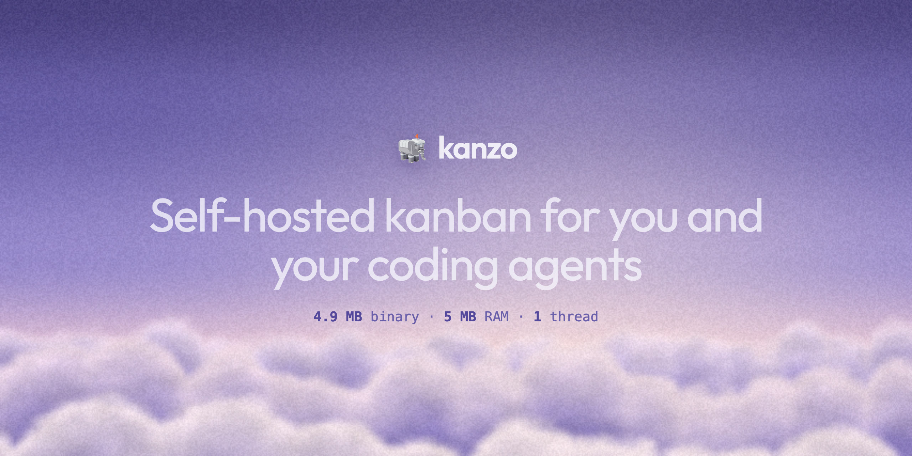
  </picture>
</p>

<p align="center">
  <a href="https://github.com/emanuele-em/kanzo/actions/workflows/ci.yml"></a>
  <a href="https://crates.io/crates/kanzo"></a>
  <a href="LICENSE"></a>
</p>

<p align="center">
  <a href="README.md">English</a> | <a href="README.zh.md">简体中文</a> | <a href="README.tr.md">Türkçe</a> | 日本語
</p>

> [!NOTE]
> これはコミュニティによる翻訳です。最新の情報は[英語版 README](README.md) を参照してください。

Kanzo は、ブラウザで動くカンバンボードと MCP サーバーをひとつの 4.7 MB のプログラムにまとめたものです。そのため、あなたとコーディングエージェントが同じタスクに取り組めます。1 台のコンピューターでも、全員で共有する 1 つのボードでも使えます。アカウントもサーバーもセットアップも不要です。`kanzo` を実行すればすぐに使えます。

ファイルを手で編集することはありません。すべての操作は次の 3 か所のいずれかで行います。

- **ボード**: ブラウザで、あなたが使います。
- **MCP**: エージェントが使います。エージェントはタスクを引き受け、カードを動かし、コメントします。
- **`kanzo` コマンド**: ターミナルやスクリプトから使います。

<picture>
  <source media="(prefers-color-scheme: dark)" srcset="docs/img/board-dark.gif">
  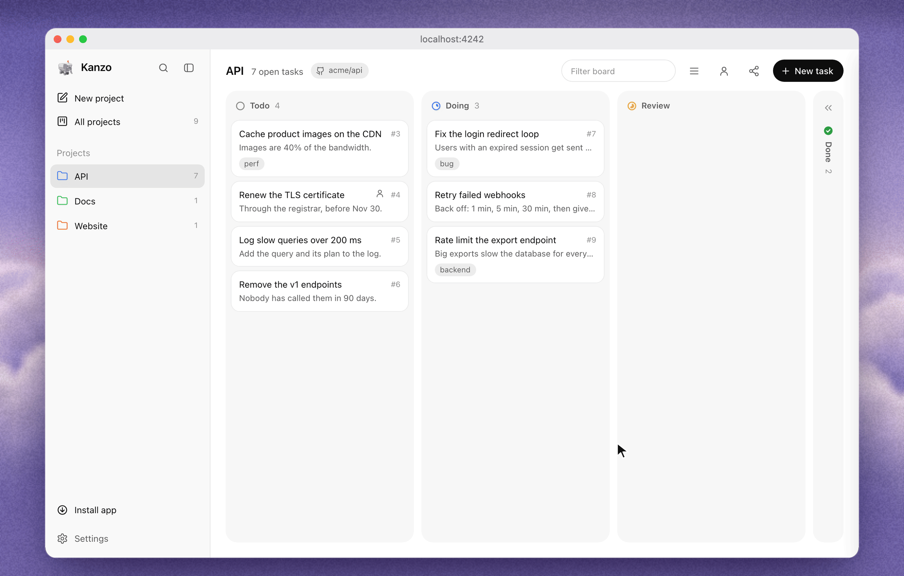
</picture>

## インストール

> [!TIP]
> **エージェントに頼むだけです:** *「github.com/emanuele-em/kanzo から Kanzo をインストールして。」*

```sh
curl -LsSf https://github.com/emanuele-em/kanzo/releases/latest/download/kanzo-installer.sh | sh
```

macOS と Linux（すべての Raspberry Pi を含む）向けです。Windows では PowerShell で次を実行します。

```powershell
powershell -ExecutionPolicy Bypass -c "irm https://github.com/emanuele-em/kanzo/releases/latest/download/kanzo-installer.ps1 | iex"
```

どちらも Kanzo を `PATH` に追加し、それ以降に開いたターミナルで使えるようになります。インストールに使ったターミナルで使うには、`source $HOME/.cargo/env`（fish の場合は `env.fish`）を実行するか、新しいターミナルを開いてください。

または、[最新リリース](https://github.com/emanuele-em/kanzo/releases/latest)から Windows 用の zip をダウンロードし、`kanzo.exe` を `PATH` 上の `bin` という名前のフォルダー（`%USERPROFILE%\.cargo\bin` など）に置いてください。ボードが自動でアップデートされるのは、その場所に置いた場合だけです。

すべてのリリースは GitHub によって署名されています。ダウンロードしたファイルは `gh attestation verify <file> --repo emanuele-em/kanzo` で検証できます。Cargo でもインストールできます。

```sh
cargo install kanzo
```

## 起動

> [!TIP]
> **エージェントに頼むだけです:** *「Kanzo を起動して、ログイン時にも動き続けるようにして。」*

```sh
kanzo
```

ボードが http://localhost:4242 で開きます。必要なセットアップはこれだけです。初回の実行で `~/kanzo` が作られ、ボード全体がその中に保存されます。

| キー | 動作 |
| --- | --- |
| `n` | 新しいタスク |
| `/` または `⌘K` | すべてのプロジェクトを検索 |
| `f` | ボードを絞り込み。`↵` で絞り込みを保持 |
| `Tab` | 説明欄に移動 |
| `⌘↵` | 保存して閉じる |
| `Esc` | 説明欄やタグに入力した内容は保持し、それ以外の欄はキャンセル |

## ボードを使う

> [!TIP]
> **エージェントに頼むだけです:** *「kanzo#12 を human にして、URL を github.com/acme/api/pull/482 に設定して。」*

- **タスクの選択:** `⌘` を押しながらクリックするか、ボードの空いている場所をドラッグして選択し、まとめて移動、タグ付け、削除できます。1 つをドラッグすると、ほかのタスクもついてきます。
- **リスト表示:** リストアイコンを押すと、同じタスクを行として表示し、並べ替えやグループ化ができます。
- **人間向けのタスク:** タスクを Human にすると、エージェントはそのタスクをあなたに任せます。人のアイコンを押すと、それらのタスクだけが表示されます。
- **画像:** タスクやコメントに貼り付けるか、ドロップしてください。
- **別のプロジェクトへの移動:** タスクのパネルで移動先を選びます。番号はそのままなので、`api#12` は `web#12` になります。エージェントは `project` で移動します。
- **リンク:** タスクにプルリクエストなどの URL を設定すると、カードから開けます。エージェントは `url` で設定します。
- **ファイル:** 説明やコメントに `[name](file:///path)` と書くと、エディターで開けます。
- **タスクパネル:** 左端をドラッグしてサイズを変えたり、ウィンドウ全体に広げたりできます。端をダブルクリックすると元に戻ります。
- **サイドバー:** 検索の横にあるパネルボタンを押すと、アイコンだけに折りたたまれます。プロジェクトをドラッグすると一覧の順番を変えられ、共有ボードでは全員に反映されます。
- **アプリ:** Chrome や Edge では、サイドバー下部の **Install app** でボードを独立したアプリにできます。`⌘1`〜`⌘8` でプロジェクトを選び、`⌘9` で最後のプロジェクト、`⌘0` ですべてのプロジェクトを表示します。macOS では、それ以降 `kanzo` がデフォルトのポートでタブの代わりにこのアプリを開きます。
- **アップデート:** 新しいバージョンが出ると、サイドバーに表示されます。1 クリックでインストールできます。

## エージェントを接続する

> [!TIP]
> **エージェントに頼むだけです:** *「Kanzo を MCP サーバーとして追加して。」* そのあとエージェントを再起動してください。

```sh
claude mcp add kanzo --scope user -- kanzo mcp   # Claude Code
codex mcp add kanzo -- kanzo mcp                 # Codex
```

ほかの MCP クライアントでは、`kanzo mcp` を実行するか（Raycast などのアプリでは `which kanzo` で調べたフルパスが必要です）、起動中のボードの `http://localhost:4242/mcp` を使ってください。

あとは *「kanzo から次のタスクを取ってやって。」* と頼むだけです。エージェントは次のように動きます。

- リポジトリの git リモートからプロジェクトを見つけます。プロジェクトの ⋯ メニューから、ほかのリポジトリも紐づけられます。
- カードを `doing` に移動し、作業しながらコメントします。
- `review` に移すとき、セッションを再開する方法をコメントします。

<picture>
  <source media="(prefers-color-scheme: dark)" srcset="docs/img/task-dark.jpg">
  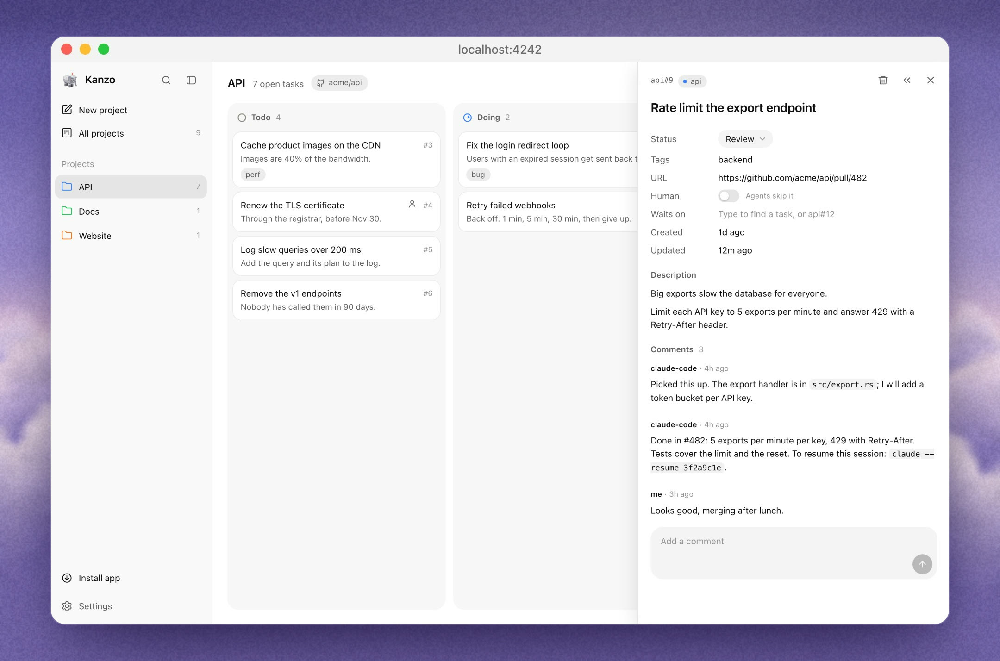
</picture>

## タスクを引き継ぐ

> [!TIP]
> **エージェントに頼むだけです:** *「作業をやめるときは、kanzo#12 を引き継ぎコメント付きで review に移して私に渡して。」*

`update_task` を 1 回呼ぶだけで、タスクを移動し、その `comment` も保存します。コメントにはエージェントのクライアント名が署名されます。両方が保存されるか、どちらも保存されないかのどちらかです。コメントが空のとき、16 KiB を超えるとき、ほかの変更が拒否されたときは、何も保存されません。

- **自分に渡す:** `status: "review"` と `escalated: true`。タスクが次に移動するまで、カードに **Escalated** と表示されます。`todo` に戻せば、またエージェントが取れるようになります。
- **ほかのエージェントに渡す:** コメント付きで `status: "todo"` にします。次のエージェントは `get_task` で読みます。
- **書くこと:** 何が起きたかを書きます。秘密の情報や会話全体は書きません:

  ```text
  Completed: 終わったこと
  Remaining: 残っていること
  Verified: 何をどう確認したか
  Next step: 最初にやること
  ```

## アイデアをバックログに置いておく

Settings で Backlog をオンにすると、エージェントが手を付けない列が追加されます。そのタスクを `todo` に移すまで、エージェントは触りません。

<picture>
  <source media="(prefers-color-scheme: dark)" srcset="docs/img/backlog-dark.jpg">
  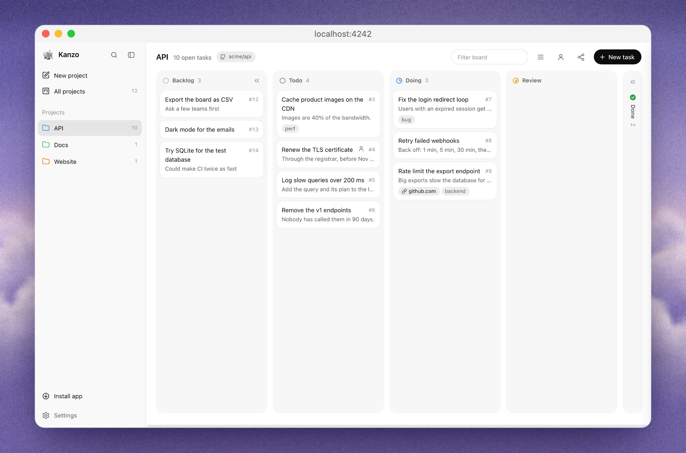
</picture>

## タスクをほかのタスクの完了待ちにする

> [!TIP]
> **エージェントに頼むだけです:** *「kanzo#12 を #10 と #11 の完了待ちにして。」*

- **設定方法:** タスクのパネルの Waits on に入力すると、そのプロジェクトのタスクが見つかるので選びます。エージェントは `waits_on` を渡します。
- **それらのタスクが完了するまで:** `next_task` はそのタスクを飛ばし、カードは薄く表示されて、何を待っているかが表示されます。自分で移動することはできます。
- **完了とみなされるもの:** `done` だけです。`review` のタスクは引き続きブロックします。
- **見つけ方:** `is:waiting` で絞り込みます。

<picture>
  <source media="(prefers-color-scheme: dark)" srcset="docs/img/waits-dark.jpg">
  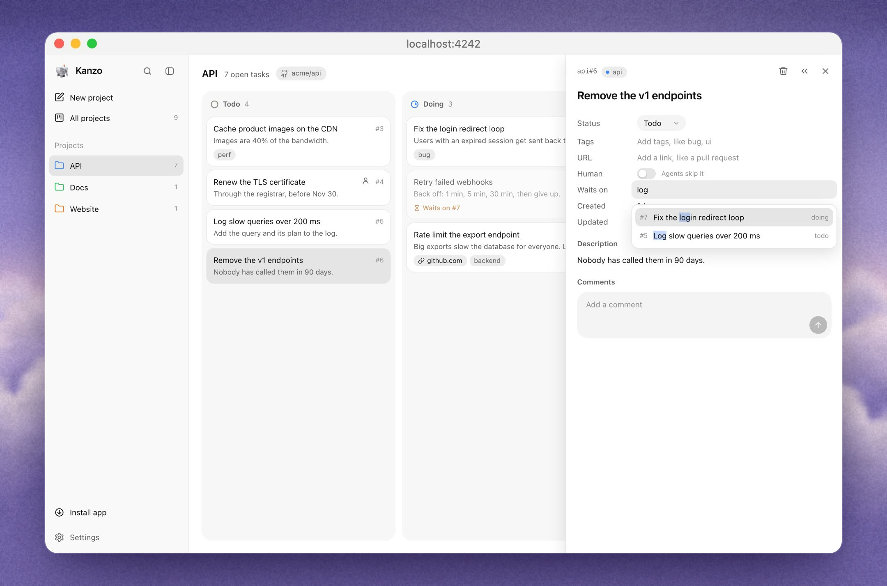
</picture>

## 変更に反応する

> [!TIP]
> **エージェントに頼むだけです:** *「kanzo のタスクが todo に入るたびにエージェントを起動するスクリプトを書いて。」*

サービスは、ボード全体を何度も読み直さなくても、ボードの変更を追いかけられます。たとえば、タスクが `todo` に入ったときにエージェントを起動できます。

- **始める:** `GET /api/events` は `{"events": [], "last": "41.9f3c…"}` を返します。カーソルである `last` を保存してください。`0` は最初のイベントより前を表します。
- **追いかける:** `GET /api/events?since=<last>&wait=25` は、何かが変わるとすぐに、イベントがなければ 25 秒後に返ります。次回は新しい `last` を渡します。1 つのプロジェクトだけなら `project=api` を追加します。
- **受け取る内容:** 各イベントには `id`、`at`、`kind`（`task.created`、`task.moved`、`task.updated`、`task.deleted`、`comment.added`）、`api#12` のような `task`、`project` があり、該当する場合は `from` と `to`（列）、コメントの `author` も含まれます。1 回の編集は 1 つのイベントです。列が変わる編集は、ほかに何を変えても `task.moved`、それ以外は `task.updated` です。列の中でカードを並べ替えてもイベントにはなりません。別のプロジェクトに移したタスクは、移動先のプロジェクトで報告されます。
- **何も失われない:** イベントは変更と同じトランザクションで書き込まれます。最新の 1,000 件、または Settings の Board で指定した件数が保持されます。
- **`"reset": true` が返ったらやり直す:** カーソルがこのボードのどのイベントも指していません。イベントが削除されたか、`kanzo sync` などでボードが置き換えられたためです。ボードを読み直してから、`last` から続けてください。
- **別のボードに参加したコンピューターでは、** `/api/events` はこのコンピューター自身のボードです。共有ボードのイベントは `/remote/api/events` にあります。

## 絞り込みと検索

> [!TIP]
> **エージェントに頼むだけです:** *「billing タグの付いた次の kanzo タスクを取って。」* または *「tag:billing で kanzo に残っているものを一覧にして。」*

ボードの絞り込み（`f`）、検索（`/`）、そして `list_tasks` と `next_task` の `filter` は、GitHub と同じように、どれも同じ語を理解します。

- すべての条件に一致する必要があります。
- `-` は修飾子を否定します: `tag:billing -status:done`。
- 修飾子は入力すると青くなります。

<picture>
  <source media="(prefers-color-scheme: dark)" srcset="docs/img/filter-dark.jpg">
  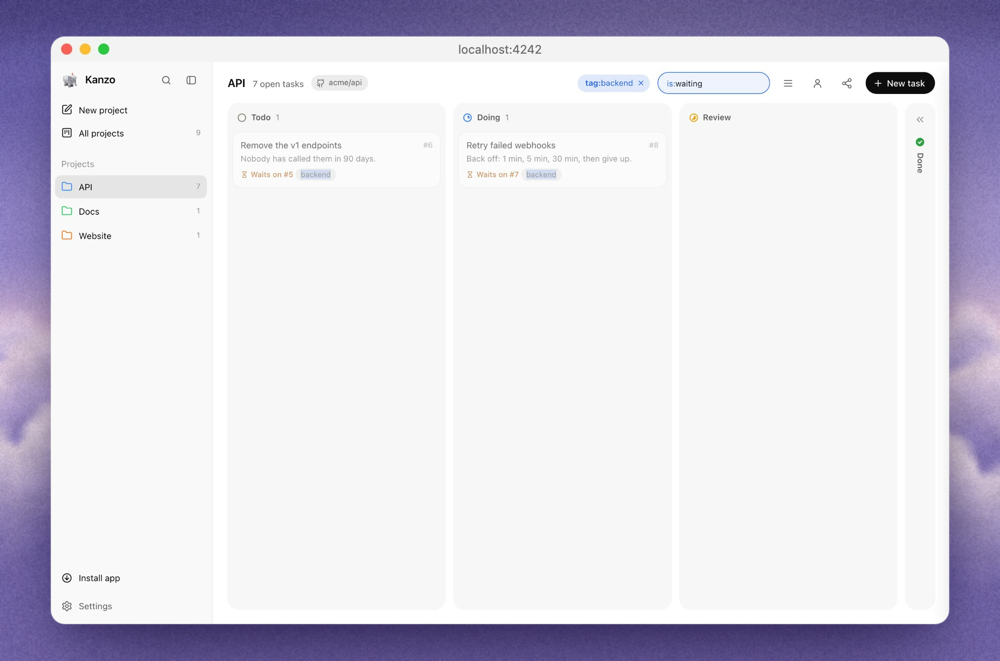
</picture>

| 修飾子 | 見つかるもの | 例 |
| --- | --- | --- |
| `tag:` | 完全に一致するタグ | `tag:bug`, `tag:"needs review"` |
| `status:` | 列 | `status:doing` |
| `project:` | プロジェクト | `project:api` |
| `title:`, `description:`, `url:`, `comment:` | その項目内のテキスト | `title:login`, `comment:"on hold"` |
| `id:`, `comments:`, `images:` | 数値、または範囲 | `id:12`, `comments:>2`, `images:1..3` |
| `created:`, `updated:` | 日付、または範囲 | `created:2026-11-05`, `updated:<2026-01-31` |
| `is:human` | エージェントではなくあなた向けのタスク | `-is:human` |
| `is:waiting` | 未完了のタスクを待っているタスク | `-is:waiting` |
| `has:`, `no:` | `description`、`tags`、`url`、`comments`、`images` | `has:url`, `no:tags` |

それ以外はすべてプレーンテキストとして扱われます。フレーズには `"on hold"` のように引用符を使い、修飾子のように見えるテキストを探すときも `"tag:bug"` のように引用符を使います。Settings で非表示にしたプロパティでは、エージェントは絞り込みできません。

## 複数のコンピューターで使う

方法は 2 つあり、どちらもセットアップは不要です。1 つのボードをリアルタイムで共有するか、マシン間で同期します。

### リアルタイムで共有する

> [!TIP]
> **エージェントに頼むだけです:** 1 台のコンピューターで *「Kanzo のボードを共有して。」*、ほかのコンピューターで *「192.168.1.20 の Kanzo ボードに参加して。」*

複数のコンピューターで 1 つのボードを同時に使えます。全員が同じタスクを見て、すべてのエージェントがそのタスクに取り組みます。

1. ボードのあるコンピューターで、New task の横にある共有アイコンをクリックし、**Share this board** をオンにします。表示されたアドレスのどれかをコピーします。

<picture>
  <source media="(prefers-color-scheme: dark)" srcset="docs/img/share-dark.jpg">
  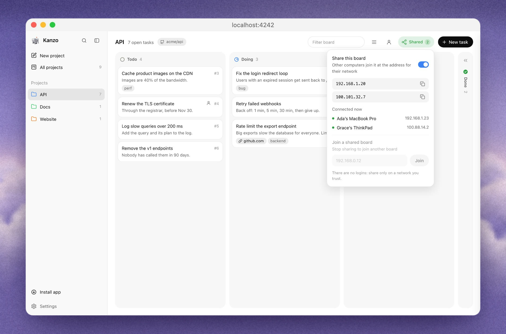
</picture>

2. ほかの各コンピューターで共有アイコンをクリックし、アドレスを貼り付けて **Join** をクリックします。

<picture>
  <source media="(prefers-color-scheme: dark)" srcset="docs/img/join-dark.jpg">
  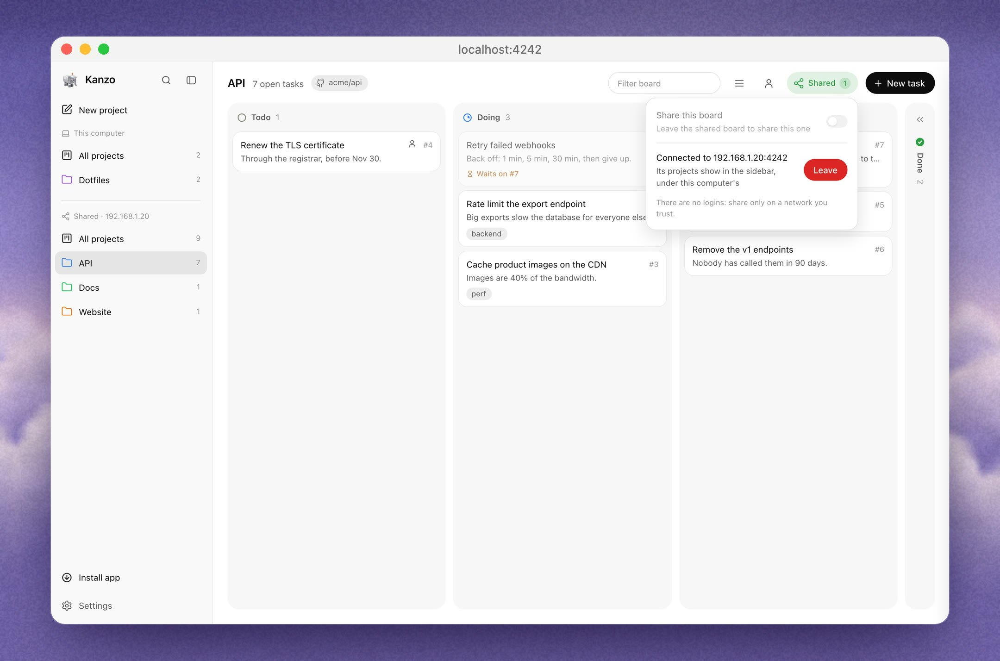
</picture>

再起動も設定も必要ありません。参加した側のサイドバーには、共有ボードのプロジェクトが自分のプロジェクトの下に表示されるので、自分の非公開プロジェクトにも 1 クリックで戻れます。エージェントも同じ `kanzo mcp` を通じて共有ボードを使い、引き続き作業中のリポジトリからプロジェクトを見つけます。共有はいつでもオフにでき、**Leave** をクリックすればいつでも抜けられます。

ターミナルやエージェントからは、`kanzo share on` と `kanzo join <address>` で始め、`kanzo share off` と `kanzo leave` で終わります。

ボードがどこにあっても同じ 2 つのコマンドで動きます。変わるのはアドレスだけです。

**自分のコンピューターがボードを共有する。** 同じネットワーク上のほかの人が、自分のコンピューターから参加します。

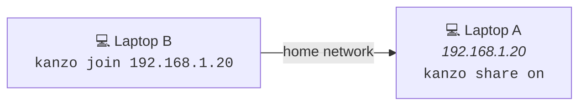

**Raspberry Pi がボードを保持する。** すべてのコンピューターがそこに参加するので、どのコンピューターも起動しておく必要がありません。

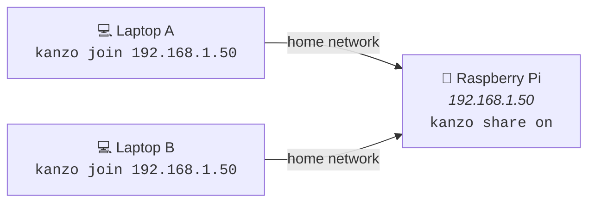

**Raspberry Pi が別の場所にあり、インターネット経由で使う。** [Tailscale](https://tailscale.com)、[NetBird](https://netbird.io)、WireGuard などの VPN を Pi と各コンピューターに入れてください。すると `kanzo share on` に Pi の VPN アドレスも表示されます。

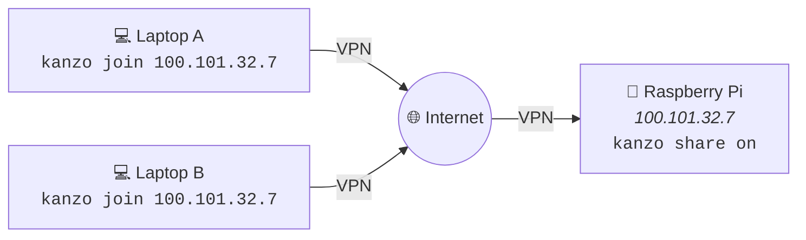

Pi では、`kanzo service install` を使うと再起動後もボードが動き続けます。ログインの仕組みはないので、共有は信頼できるネットワークでだけ行ってください。

### マシン間で同期する

> [!TIP]
> **エージェントに頼むだけです:** *「Kanzo のボードを同期して。」* または初回なら *「github.com/you/kanzo-data で Kanzo の同期を設定して。」*

一度に 1 台ずつ使う複数のマシンの間でボードを持ち運ぶには、自分が所有する非公開の git リポジトリを使って同期します。

1. GitHub、または git で push できる任意の場所に、[空の非公開リポジトリを作成](https://github.com/new?name=kanzo-data&visibility=private)します。
2. サイドバー下部の Settings をクリックし、Sync を選んで、リポジトリの URL を貼り付けます。Kanzo が `~/kanzo` を git リポジトリにして、ボードを push します。
3. ほかの各マシンでも、同じ URL で同じ操作をします。Kanzo が、すでにあるボードを使うか確認します。

それ以降は、マシンを切り替えるときに Sync を選ぶか、`kanzo sync` を実行してください。ボードをコミットして pull または push します。ボードやエージェントが動いている間でも安全です。両方のマシンでボードが変更されていた場合は、どちらを残すか Kanzo が確認します。別のリポジトリに切り替えるには、Settings の Sync で変更してください。

## コマンド

| コマンド | 動作 |
| --- | --- |
| `kanzo` | http://localhost:4242 でボードを起動して開きます。別のポートにするには `--port`、開かないようにするには `--no-open` |
| `kanzo service install` | ボードを動かし続け、ログイン時に起動します。`uninstall` で削除します |
| `kanzo mcp` | エージェント向けの MCP サーバーです。起動するのはあなたではなくエージェントです |
| `kanzo share on` | ネットワーク上のほかのコンピューターとボードを共有します。`off` で共有を止めますが、ボードは動き続けます |
| `kanzo join <ip>` | 別のコンピューターが共有しているボードを、このコンピューターのボードとエージェントから使います。`kanzo leave` で元に戻ります |
| `kanzo sync` | ボードをコミットして pull または push します。`--repo <url>` でリポジトリを設定し、両方で変更があった場合は `--keep-local` または `--keep-remote` を指定します |
| `kanzo export` | ボードを Markdown で出力します。JSON にするには `-f json`、1 つのプロジェクトだけなら `-p <project>`、保存するには `-o <file>` |
| `kanzo update` | 最新リリースをインストールし、ボードのサービスを再起動します。ボードからも新しいバージョンを案内します |
| `kanzo init` | データフォルダーを作成します。初回の実行でも作成されます |
| `kanzo --version` | バージョンを表示します |

すべてのコマンドで `--home <dir>` を指定すると、別のデータフォルダーを使えます。

## 設定

> [!TIP]
> **エージェントに頼むだけです:** *「Kanzo をポート 4300 で動かして。」*

すべては `~/kanzo` にあります。ボードは `kanzo.db`、設定は `config.toml` に保存されます。どちらも開く必要はありません。別のフォルダーを使うには `--home` または `KANZO_HOME` を指定します。

```toml
port = 4242
listen = "127.0.0.1"   # sharing opens the board to your network; "0.0.0.0" keeps it open
mcp_http = true        # MCP at /mcp
editor = "/usr/local/bin/cursor"   # opens file:/// links; on macOS, your text editor without it
hosts = ["board.example.ts.net"]   # names a reverse proxy here serves the board under; they can't open files or change sharing
```

これらの設定は各マシンに残り、`kanzo sync` の対象には含まれません。

ボード上の設定:

- **Task properties:** タグやコメントなどをオフにすると、ボードで非表示になり、エージェントが受け取る情報からも除かれます。何も削除はされません。
- **Language:** Board の下で、英語または中国語を選べます。
- **Theme:** Board の下で、システム、ライト、ダークを選べます。
- **What's new:** About の下で、このバージョンのリリースノートを確認できます。

## 小さくて速い

| | |
| --- | --- |
| プログラム | 4.7 MB（SQLite を含む） |
| メモリ | アイドル時 5 MB、3,000 タスクで 12 MB |
| 起動 | 3 ms |
| 3,000 タスクのボード | ブラウザでの読み込みに 17 ms |
| エージェント向けのツール一覧 | 約 1,000 トークン、セッションごとに 1 回 |
| エージェントへの返答 | 10〜60 トークンのプレーンテキスト |

Apple M4 で計測しました。

## ライセンス

[AGPL-3.0](LICENSE): 自由に使い、変更し、共有できます。変更したバージョンをネットワーク経由で提供する場合は、そのソースも共有してください。貢献するには [CONTRIBUTING](.github/CONTRIBUTING.md) を参照してください。

<sub>mcp-name: io.github.emanuele-em/kanzo</sub>
