<p align="center">
  <picture>
    <source media="(prefers-color-scheme: dark)" srcset="docs/img/kanzo-dark.jpg">
    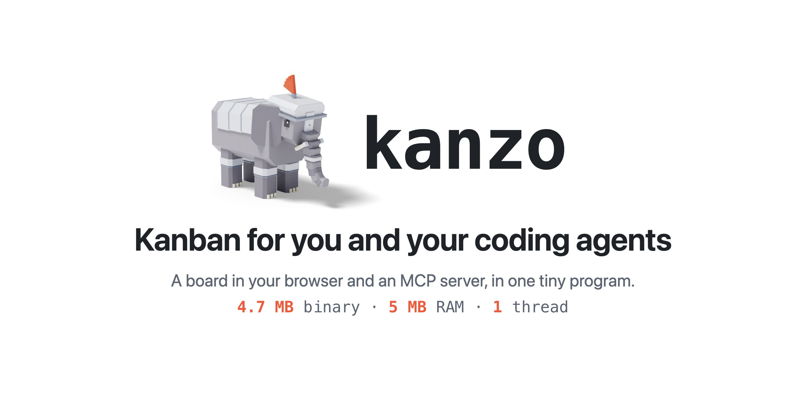
  </picture>
</p>

<p align="center">
  <a href="https://github.com/emanuele-em/kanzo/actions/workflows/ci.yml"></a>
  <a href="https://crates.io/crates/kanzo"></a>
  <a href="LICENSE"></a>
</p>

<p align="center">
  English | <a href="README.zh.md">简体中文</a>
</p>

Kanzo is a kanban board in your browser and an MCP server in one 4.7 MB program, so you and your coding agents work on the same tasks: on one computer, or on one board shared by all of them. No account, no server, no setup: run `kanzo` and it works.

You never edit a file. Everything is done in one of three places:

- **the board**, in your browser, for you;
- **MCP**, for your agents: they take tasks, move cards and comment;
- **the `kanzo` command**, for the terminal and scripts.

<picture>
  <source media="(prefers-color-scheme: dark)" srcset="docs/img/board-dark.gif">
  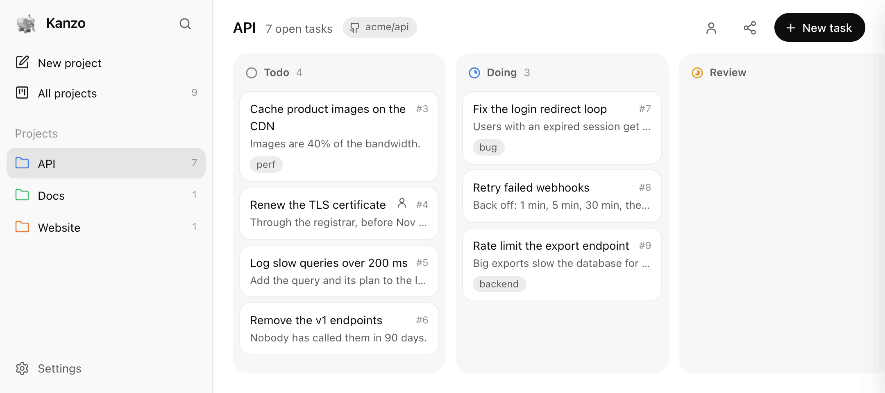
</picture>

## Install

> [!TIP]
> **Just ask your agent:** *"install Kanzo from github.com/emanuele-em/kanzo."*

```sh
curl -LsSf https://github.com/emanuele-em/kanzo/releases/latest/download/kanzo-installer.sh | sh
```

For macOS and Linux, including every Raspberry Pi. On Windows, in PowerShell:

```powershell
powershell -ExecutionPolicy Bypass -c "irm https://github.com/emanuele-em/kanzo/releases/latest/download/kanzo-installer.ps1 | iex"
```

Both add Kanzo to your `PATH`, for terminals you open from then on. To use it in the one you installed from, run `source $HOME/.cargo/env` (`env.fish` in fish), or open a new one.

Or download the Windows zip from the [latest release](https://github.com/emanuele-em/kanzo/releases/latest) and put `kanzo.exe` in a folder named `bin` on your `PATH`, like `%USERPROFILE%\.cargo\bin`: the board updates itself only there.

Every release is signed by GitHub: check a download with `gh attestation verify <file> --repo emanuele-em/kanzo`. Or with Cargo:

```sh
cargo install kanzo
```

## Start

> [!TIP]
> **Just ask your agent:** *"start Kanzo and keep it running at login."*

```sh
kanzo
```

The board opens at http://localhost:4242. That's all the setup there is: the first run creates `~/kanzo`, and the whole board lives in it.

| Key | Does |
| --- | --- |
| `n` | New task |
| `/` or `⌘K` | Search every project |
| `f` | Filter the board; `↵` keeps the filter |
| `Tab` | Move to the description |
| `⌘↵` | Save and close |
| `Esc` | Keep what you typed in a description or tags; cancel other fields |

## Use the board

> [!TIP]
> **Just ask your agent:** *"mark kanzo#12 as human, and set its URL to github.com/acme/api/pull/482."*

- **Select tasks:** `⌘`-click them, or drag on empty board space, then move, tag or delete them together. Drag one and the rest follow.
- **List view:** the list icon shows the same tasks as rows to sort and group.
- **Human tasks:** mark a task Human and agents leave it to you. The person icon shows only those.
- **Images:** paste or drop one into a task or a comment.
- **Links:** give a task a URL, like its pull request, and open it from its card. Agents set it with `url`.
- **Files:** `[name](file:///path)` in a description or comment opens in your editor.
- **Task panel:** drag its left edge to resize it, or expand it to the whole window. Double-click the edge to reset it.
- **Sidebar:** the panel button beside search folds it to its icons. Drag a project to reorder the list, for everyone on a shared board.
- **App:** in Chrome or Edge, **Install app** at the bottom of the sidebar makes the board an app of its own. `⌘1`–`⌘8` pick a project, `⌘9` the last one, `⌘0` all of them. On macOS, `kanzo` then opens it instead of a tab, on the default port.
- **Updates:** when a new version is out, the sidebar offers it. One click installs it.

## Connect your agents

> [!TIP]
> **Just ask your agent:** *"add Kanzo as your MCP server,"* then restart it.

```sh
claude mcp add kanzo --scope user -- kanzo mcp   # Claude Code
codex mcp add kanzo -- kanzo mcp                 # Codex
```

Other MCP clients: run `kanzo mcp` (apps like Raycast need the full path, from `which kanzo`), or use the running board at `http://localhost:4242/mcp`.

Then ask: *"take the next task from kanzo and do it."* The agent:

- finds the project from the git remote of its repo; link more repos from the project's ⋯ menu;
- moves the card to `doing` and comments as it works;
- on `review`, comments how to resume its session.

<picture>
  <source media="(prefers-color-scheme: dark)" srcset="docs/img/task-dark.jpg">
  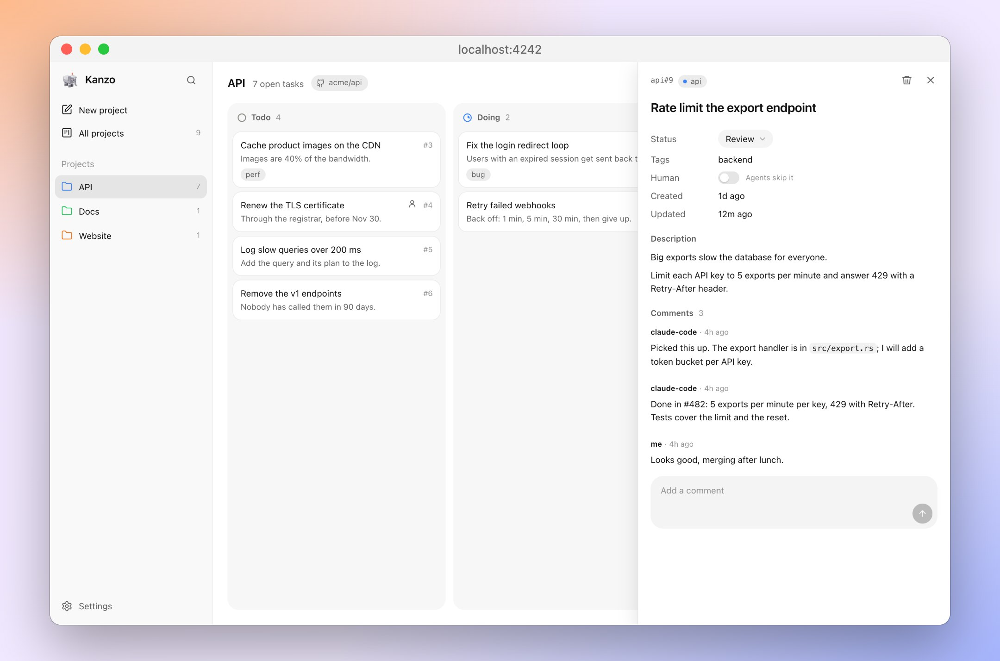
</picture>

## Park ideas in a backlog

Turn on Backlog in Settings for a column agents leave alone, until you move its tasks to `todo`.

<picture>
  <source media="(prefers-color-scheme: dark)" srcset="docs/img/backlog-dark.jpg">
  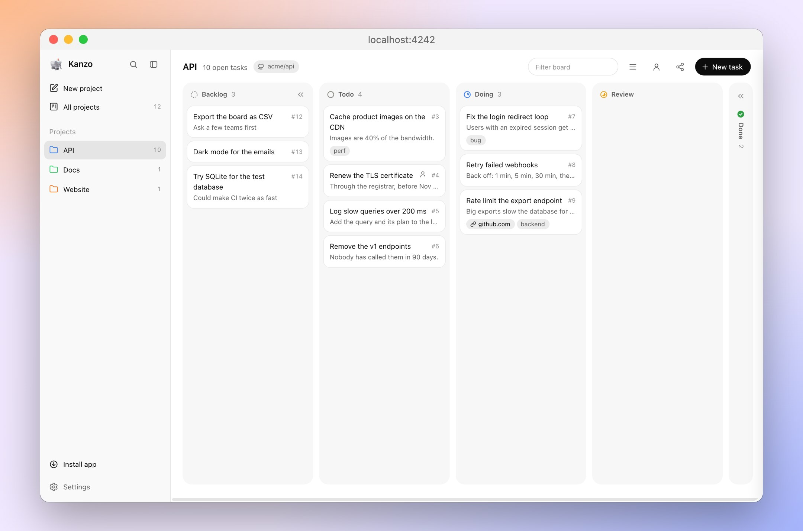
</picture>

## Make a task wait on others

> [!TIP]
> **Just ask your agent:** *"make kanzo#12 wait on #10 and #11."*

- **Set it:** type in Waits on, in a task's panel, to find tasks in its project and pick them. Agents pass `waits_on`.
- **Until those tasks are done:** `next_task` skips it, and its card is dimmed and says what it waits on. You can still move it yourself.
- **What counts:** only `done`. A task in `review` still blocks.
- **Find them:** filter by `is:waiting`.

<picture>
  <source media="(prefers-color-scheme: dark)" srcset="docs/img/waits-dark.jpg">
  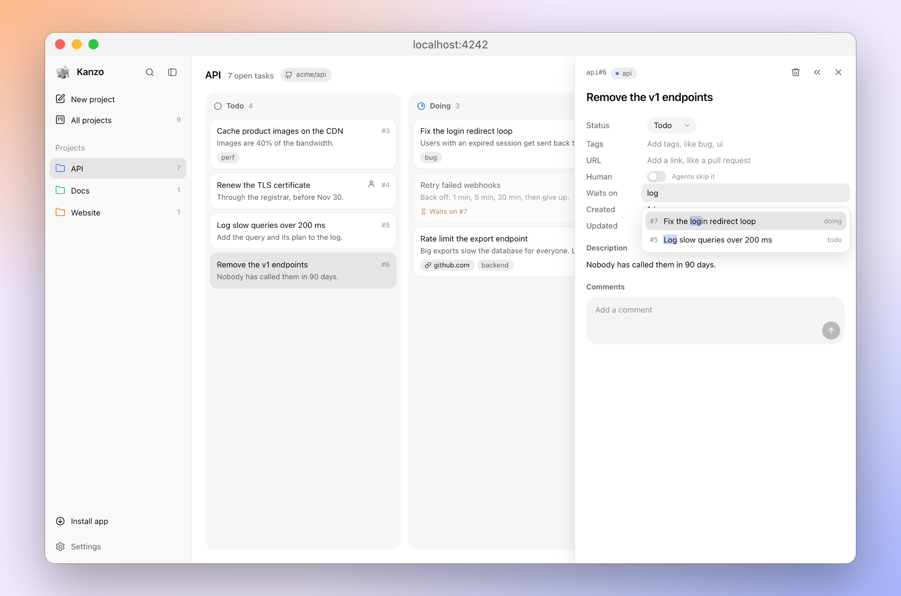
</picture>

## Filter and search

> [!TIP]
> **Just ask your agent:** *"take the next kanzo task tagged billing,"* or *"list what's left in kanzo with tag:billing."*

The board's filter (`f`), search (`/`) and the `filter` of `list_tasks` and `next_task` all understand the same words, like on GitHub:

- Every part must match.
- `-` negates a qualifier: `tag:billing -status:done`.
- Qualifiers turn blue as you type them.

<picture>
  <source media="(prefers-color-scheme: dark)" srcset="docs/img/filter-dark.jpg">
  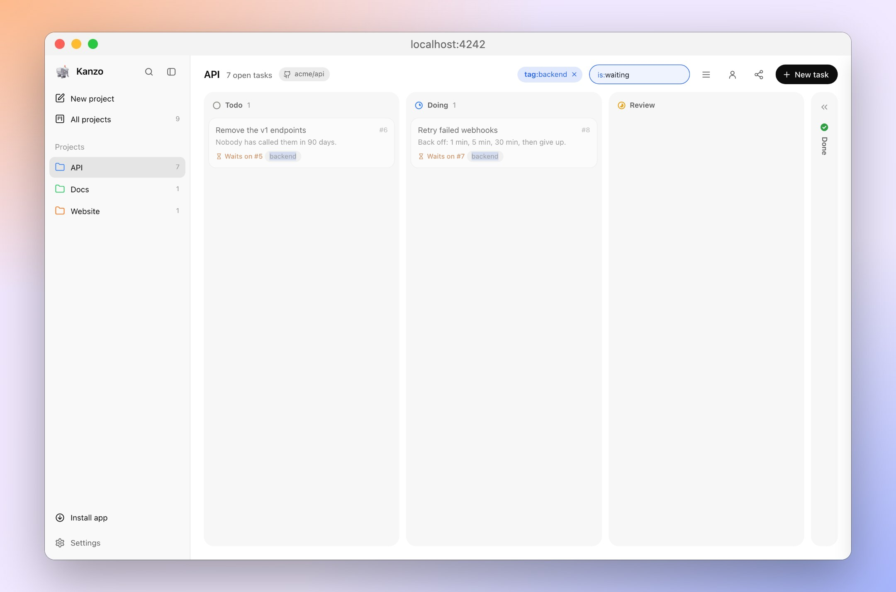
</picture>

| Qualifier | Finds | Example |
| --- | --- | --- |
| `tag:` | that exact tag | `tag:bug`, `tag:"needs review"` |
| `status:` | a column | `status:doing` |
| `project:` | a project | `project:api` |
| `title:`, `description:`, `url:`, `comment:` | text in that field | `title:login`, `comment:"on hold"` |
| `id:`, `comments:`, `images:` | a number, or a range | `id:12`, `comments:>2`, `images:1..3` |
| `created:`, `updated:` | a date, or a range | `created:2026-11-05`, `updated:<2026-01-31` |
| `is:human` | tasks for you, not agents | `-is:human` |
| `is:waiting` | tasks waiting on unfinished ones | `-is:waiting` |
| `has:`, `no:` | `description`, `tags`, `url`, `comments` or `images` | `has:url`, `no:tags` |

Anything else is plain text. Use quotes for a phrase, `"on hold"`, or to look for text that reads like a qualifier, `"tag:bug"`. Agents can't filter through a property you've hidden in Settings.

## Use it on several computers

Two ways, neither with any setup: share one board live, or sync it between machines.

### Share it live

> [!TIP]
> **Just ask your agent:** *"share my Kanzo board"* on one computer, and *"join the Kanzo board at 192.168.1.20"* on the others.

Several computers, one board, at the same time: everyone sees the same tasks, and every agent works on them.

1. On the computer with the board, click the share icon next to New task and turn on **Share this board**. Copy an address it shows.

<picture>
  <source media="(prefers-color-scheme: dark)" srcset="docs/img/share-dark.jpg">
  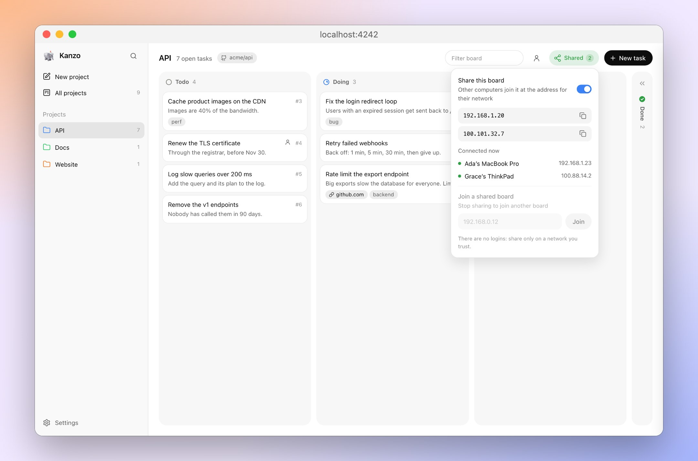
</picture>

2. On each other computer, click the share icon, paste the address and click **Join**.

<picture>
  <source media="(prefers-color-scheme: dark)" srcset="docs/img/join-dark.jpg">
  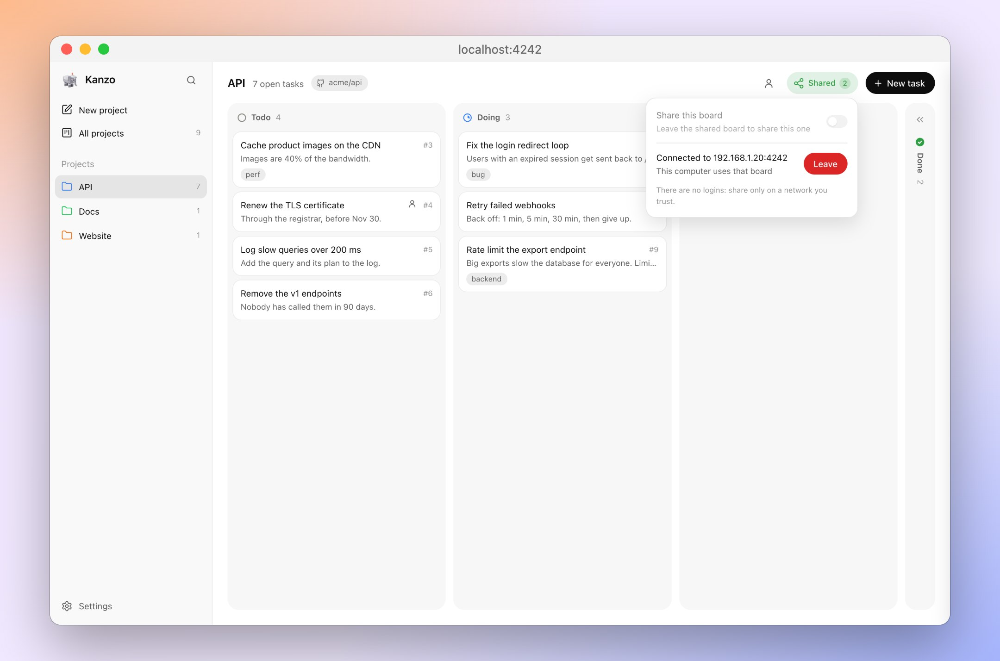
</picture>

Nothing restarts and nothing needs configuring. Their board shows the shared one, and their agents use it through the same `kanzo mcp`, still finding the project from the repo they work in. Turn sharing off, or click **Leave**, at any time.

From a terminal, or for an agent, it's `kanzo share on` and `kanzo join <address>`, then `kanzo share off` and `kanzo leave`.

The same two commands work wherever the board lives; only the address changes:

**Your computer shares its board.** Others join it from theirs, on the same network.

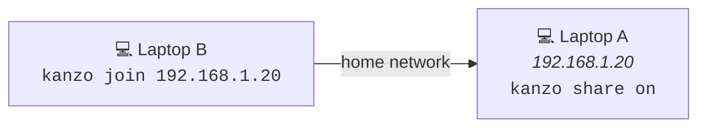

**A Raspberry Pi keeps the board.** Every computer joins it, and none has to stay on.

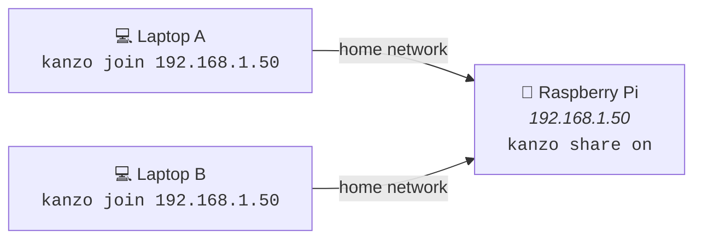

**The Raspberry Pi is somewhere else, over the internet.** Put a VPN on the Pi and on each computer, like [Tailscale](https://tailscale.com), [NetBird](https://netbird.io) or WireGuard: `kanzo share on` then shows the Pi's VPN address too.

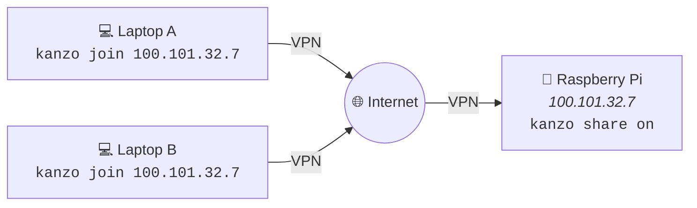

On a Pi, `kanzo service install` keeps the board running after a restart. There are no logins: share only on a network you trust.

### Sync it between machines

> [!TIP]
> **Just ask your agent:** *"sync my Kanzo board,"* or the first time, *"set up Kanzo sync with github.com/you/kanzo-data."*

To carry the board between machines you use one at a time, a private git repo you own keeps it in step.

1. [Create an empty private repo](https://github.com/new?name=kanzo-data&visibility=private) on GitHub, or anywhere git can push.
2. Click Settings at the bottom of the sidebar, choose Sync and paste its URL. Kanzo makes `~/kanzo` a git repo and pushes the board.
3. On each other machine, do the same with the same URL: Kanzo offers to use the board that's already there.

From then on, choose Sync, or run `kanzo sync`, when you switch machines. It commits the board and pulls or pushes it, and it's safe while the board and your agents are running. If both machines changed the board, Kanzo asks which one to keep. To move to another repo, change it in Settings, under Sync.

## Commands

| Command | Does |
| --- | --- |
| `kanzo` | Starts the board at http://localhost:4242 and opens it; `--port` for another port, `--no-open` to not open it |
| `kanzo service install` | Keeps the board running and starts it at login; `uninstall` removes it |
| `kanzo mcp` | The MCP server for agents: they start it, not you |
| `kanzo share on` | Shares the board with the other computers on your network; `off` stops, while the board keeps running |
| `kanzo join <ip>` | Uses the board another computer shares, from this one's board and agents; `kanzo leave` goes back |
| `kanzo sync` | Commits the board and pulls or pushes it; `--repo <url>` sets the repo, `--keep-local` or `--keep-remote` when both sides changed |
| `kanzo export` | Prints the board as Markdown; `-f json` for JSON, `-p <project>` for one project, `-o <file>` to save it |
| `kanzo update` | Installs the latest release and restarts the board's service; the board offers new versions too |
| `kanzo init` | Creates the data folder; the first run does this too |
| `kanzo --version` | Prints the version |

Every command takes `--home <dir>` to use another data folder.

## Settings

> [!TIP]
> **Just ask your agent:** *"run Kanzo on port 4300."*

Everything lives in `~/kanzo`: the board in `kanzo.db`, settings in `config.toml`. You never need to open either; use another folder with `--home` or `KANZO_HOME`.

```toml
port = 4242
listen = "127.0.0.1"   # sharing opens the board to your network; "0.0.0.0" keeps it open
mcp_http = true        # MCP at /mcp
editor = "/usr/local/bin/cursor"   # opens file:/// links; on macOS, your text editor without it
```

These settings stay on each machine: `kanzo sync` leaves them out.

Settings on the board:

- **Task properties:** turn one off, like tags or comments, to hide it there and leave it out of what agents get. Nothing is deleted.
- **Language:** English or Chinese, under Board.
- **What's new:** this version's notes, under About.

## Small and fast

| | |
| --- | --- |
| Program | 4.7 MB, SQLite included |
| Memory | 5 MB idle, 12 MB with 3,000 tasks |
| Start | 3 ms |
| Board of 3,000 tasks | 17 ms to load in the browser |
| Agents' tool list | about 1,000 tokens, once per session |
| Agents' replies | 10 to 60 tokens of plain text |

Measured on an Apple M4.

## License

[AGPL-3.0](LICENSE): use it, change it and share it; if you offer a changed version over a network, share its source too. To help, see [CONTRIBUTING](.github/CONTRIBUTING.md).

<sub>mcp-name: io.github.emanuele-em/kanzo</sub>
