<p align="center">
  <picture>
    <source media="(prefers-color-scheme: dark)" srcset="docs/img/kanzo-dark.jpg">
    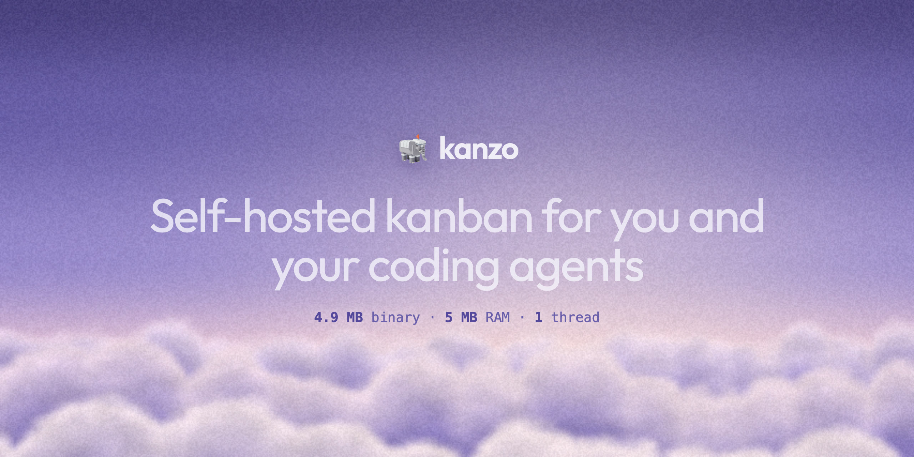
  </picture>
</p>

<p align="center">
  <a href="https://github.com/emanuele-em/kanzo/actions/workflows/ci.yml"></a>
  <a href="https://crates.io/crates/kanzo"></a>
  <a href="LICENSE"></a>
</p>

<p align="center">
  <a href="README.md">English</a> | <a href="README.zh.md">简体中文</a> | Türkçe | <a href="README.ja.md">日本語</a>
</p>

> [!NOTE]
> Bu, topluluk tarafından yapılmış bir çeviridir. En güncel bilgi için [İngilizce README](README.md)'ye bakın.

Kanzo, tarayıcında çalışan bir kanban panosuyla bir MCP sunucusunu tek bir 4,7 MB'lık programda birleştirir; böylece sen ve kodlama ajanların aynı görevler üzerinde çalışırsınız: tek bir bilgisayarda ya da hepsinin paylaştığı tek bir panoda. Hesap yok, sunucu yok, kurulum yok: `kanzo` komutunu çalıştır, çalışır.

Hiçbir dosyayı elle düzenlemezsin. Her şey şu üç yerden birinde yapılır:

- **pano**, tarayıcında, senin için;
- **MCP**, ajanların için: görev alırlar, kartları taşırlar ve yorum yazarlar;
- **`kanzo` komutu**, terminal ve betikler için.

<picture>
  <source media="(prefers-color-scheme: dark)" srcset="docs/img/board-dark.gif">
  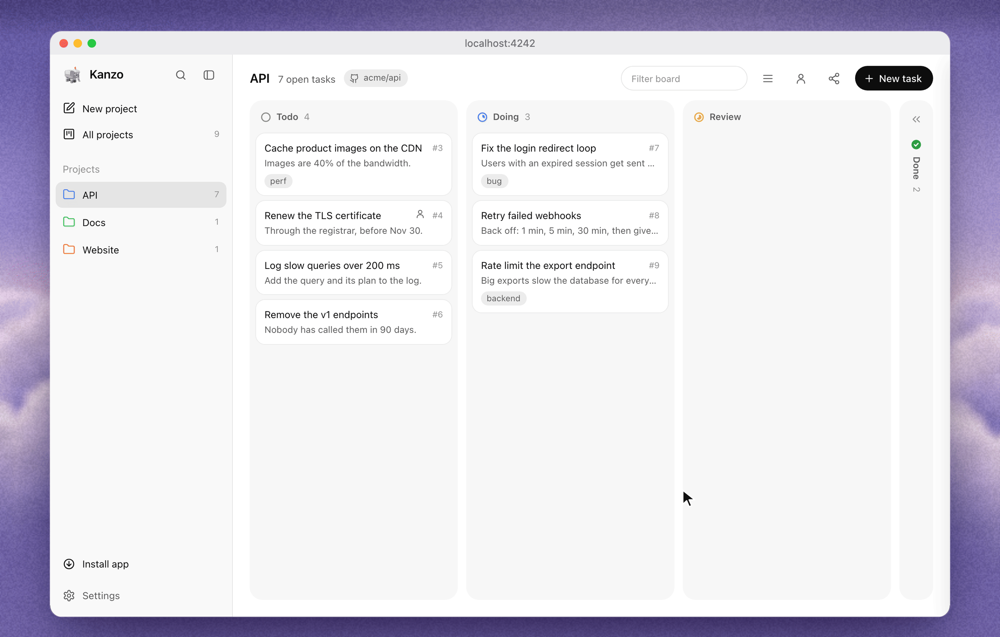
</picture>

## Kurulum

> [!TIP]
> **Ajanına söylemen yeterli:** *"github.com/emanuele-em/kanzo adresinden Kanzo'yu kur."*

```sh
curl -LsSf https://github.com/emanuele-em/kanzo/releases/latest/download/kanzo-installer.sh | sh
```

macOS ve Linux için; bütün Raspberry Pi modelleri dahil. Windows'ta PowerShell'de:

```powershell
powershell -ExecutionPolicy Bypass -c "irm https://github.com/emanuele-em/kanzo/releases/latest/download/kanzo-installer.ps1 | iex"
```

İkisi de Kanzo'yu `PATH`'ine ekler; bundan sonra açacağın terminallerde geçerli olur. Kurulumu yaptığın terminalde kullanmak için `source $HOME/.cargo/env` çalıştır (fish'te `env.fish`) ya da yeni bir terminal aç.

Ya da [son sürümden](https://github.com/emanuele-em/kanzo/releases/latest) Windows zip dosyasını indir ve `kanzo.exe`'yi `PATH`'inde bulunan `bin` adlı bir klasöre koy, örneğin `%USERPROFILE%\.cargo\bin`: pano kendini yalnızca orada güncelleyebilir.

Her sürüm GitHub tarafından imzalanır: indirdiğin dosyayı `gh attestation verify <dosya> --repo emanuele-em/kanzo` ile doğrula. Ya da Cargo ile:

```sh
cargo install kanzo
```

## Başlat

> [!TIP]
> **Ajanına söylemen yeterli:** *"Kanzo'yu başlat ve oturum açınca çalışır halde kalsın."*

```sh
kanzo
```

Pano http://localhost:4242 adresinde açılır. Bütün kurulum bundan ibaret: ilk çalıştırma `~/kanzo` klasörünü oluşturur ve panonun tamamı orada durur.

| Tuş | Ne yapar |
| --- | --- |
| `n` | Yeni görev |
| `/` ya da `⌘K` | Bütün projelerde ara |
| `f` | Panoyu filtrele; `↵` filtreyi korur |
| `Tab` | Açıklamaya geç |
| `⌘↵` | Kaydet ve kapat |
| `Esc` | Açıklamaya ya da etiketlere yazdığını korur; diğer alanlarda iptal eder |

## Panoyu kullan

> [!TIP]
> **Ajanına söylemen yeterli:** *"kanzo#12'yi human olarak işaretle ve URL'sini github.com/acme/api/pull/482 yap."*

- **Görev seçme:** `⌘` ile tıkla ya da panonun boş bir yerinde sürükle; sonra hepsini birlikte taşı, etiketle ya da sil. Birini sürüklersen diğerleri de peşinden gelir.
- **Liste görünümü:** liste simgesi aynı görevleri sıralanıp gruplanabilen satırlar olarak gösterir.
- **İnsan görevleri:** bir görevi Human olarak işaretlersen ajanlar onu sana bırakır. Kişi simgesi yalnızca bunları gösterir.
- **Görseller:** bir göreve ya da yoruma yapıştır veya sürükleyip bırak.
- **Başka projeye taşıma:** görev panelinden projeyi seç. Numarası aynı kalır, yani `api#12` `web#12` olur. Ajanlar bunu `project` ile taşır.
- **Bağlantılar:** göreve bir URL ver (örneğin pull request'i) ve kartından aç. Ajanlar bunu `url` ile ayarlar.
- **Dosyalar:** bir açıklamada ya da yorumda `[ad](file:///yol)` editöründe açılır.
- **Görev paneli:** boyutunu değiştirmek için sol kenarını sürükle ya da bütün pencereye genişlet. Varsayılana döndürmek için kenara çift tıkla.
- **Kenar çubuğu:** aramanın yanındaki panel düğmesi onu simgelerine kadar daraltır. Listeyi yeniden sıralamak için bir projeyi sürükle; paylaşılan panoda bu herkes için geçerli olur.
- **Uygulama:** Chrome ya da Edge'de kenar çubuğunun altındaki **Install app** panoyu ayrı bir uygulama yapar. `⌘1`–`⌘8` bir proje seçer, `⌘9` sonuncusunu, `⌘0` hepsini. macOS'ta bundan sonra `kanzo`, varsayılan portta, sekme yerine bu uygulamayı açar.
- **Güncellemeler:** yeni sürüm çıktığında kenar çubuğu bunu önerir. Tek tıkla kurulur.

## Ajanlarını bağla

> [!TIP]
> **Ajanına söylemen yeterli:** *"Kanzo'yu MCP sunucun olarak ekle,"* sonra ajanı yeniden başlat.

```sh
claude mcp add kanzo --scope user -- kanzo mcp   # Claude Code
codex mcp add kanzo -- kanzo mcp                 # Codex
```

Diğer MCP istemcileri: `kanzo mcp` çalıştır (Raycast gibi uygulamalar `which kanzo` ile bulacağın tam yolu ister) ya da çalışan panonun `http://localhost:4242/mcp` adresini kullan.

Sonra şunu iste: *"kanzo'dan sıradaki görevi al ve yap."* Ajan:

- projeyi, bulunduğu reponun git remote adresinden bulur; projenin ⋯ menüsünden başka repolar da bağlayabilirsin;
- kartı `doing` sütununa taşır ve çalışırken yorum yazar;
- `review` aşamasında, oturumuna nasıl devam edileceğini yorum olarak yazar.

<picture>
  <source media="(prefers-color-scheme: dark)" srcset="docs/img/task-dark.jpg">
  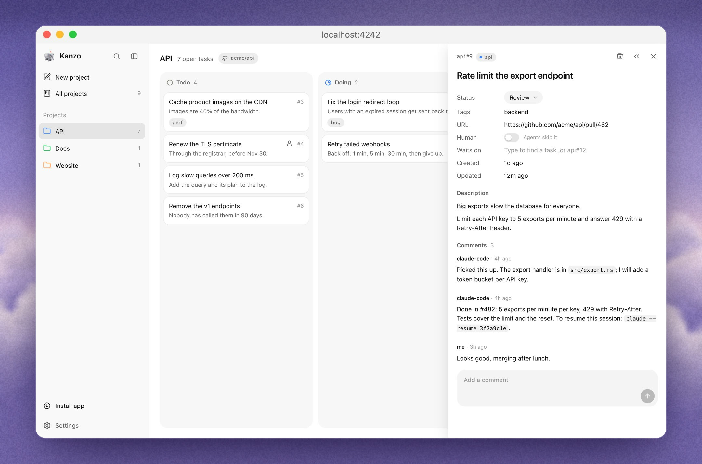
</picture>

## Bir görevi devret

> [!TIP]
> **Ajanına söylemen yeterli:** *"durduğunda kanzo#12'yi bir devir yorumuyla bana review'a taşı."*

Tek bir `update_task` çağrısı görevi taşır ve `comment`'ini kaydeder; yorum ajanın istemci adıyla imzalanır. İkisi birlikte kaydedilir ya da hiçbiri: boş bir yorum, 16 KiB'tan uzun bir yorum ya da reddedilen herhangi bir değişiklik hiçbir şey kaydetmez.

- **Sana:** `status: "review"` ile `escalated: true`. Görev bir sonraki taşınışına kadar kartta **Escalated** yazar; `todo`'ya geri sürüklersen görev yine ajanlara kalır. Settings'te Notifications açıksa pano sana haber verir.
- **Başka bir ajana:** yorumla birlikte `status: "todo"`; sonraki ajan onu `get_task` ile okur.
- **Ne yazılır:** ne olduğu; sırlar ya da konuşmanın tamamı değil:

  ```text
  Completed: biten iş
  Remaining: kalan iş
  Verified: neyin nasıl kontrol edildiği
  Next step: ilk yapılacak şey
  ```

## Fikirleri backlog'a park et

Settings'te Backlog'u açarsan ajanların dokunmadığı bir sütun gelir; görevlerini `todo` sütununa taşıyana kadar orada bekler.

<picture>
  <source media="(prefers-color-scheme: dark)" srcset="docs/img/backlog-dark.jpg">
  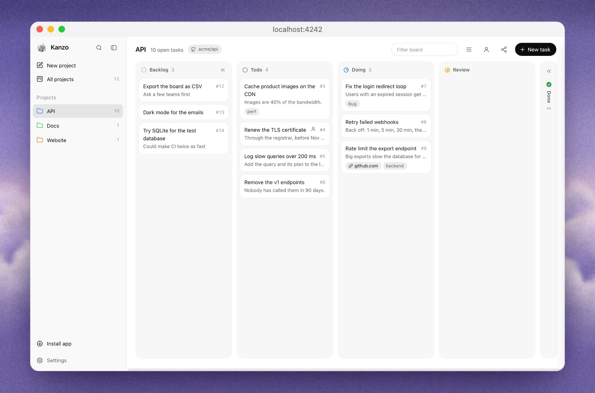
</picture>

## Bir görevi başkalarını beklet

> [!TIP]
> **Ajanına söylemen yeterli:** *"kanzo#12, #10 ve #11'i beklesin."*

- **Ayarlama:** görevin panelindeki Waits on alanına yaz; projedeki görevleri bulup seç. Ajanlar `waits_on` gönderir.
- **O görevler bitene kadar:** `next_task` onu atlar; kartı soluk görünür ve neyi beklediğini yazar. Sen yine de elle taşıyabilirsin.
- **Ne sayılır:** yalnızca `done`. `review` aşamasındaki bir görev hâlâ engeller.
- **Bulma:** `is:waiting` ile filtrele.

<picture>
  <source media="(prefers-color-scheme: dark)" srcset="docs/img/waits-dark.jpg">
  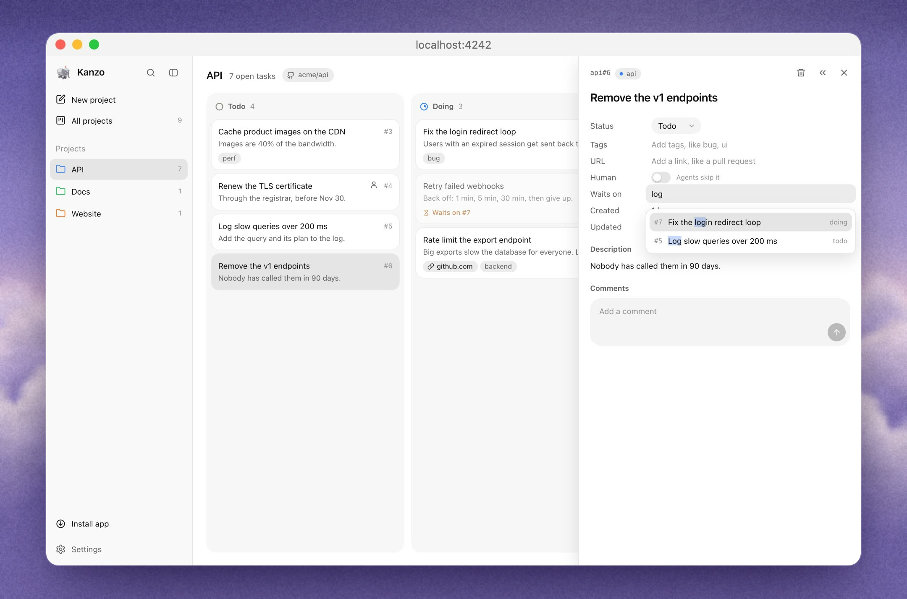
</picture>

## Değişikliklere tepki ver

> [!TIP]
> **Ajanına söylemen yeterli:** *"todo'ya bir kanzo görevi düştüğünde bir ajan başlatan bir betik yaz."*

Bir servis, panonun tamamını tekrar tekrar okumadan değişiklikleri takip edebilir; örneğin bir görev `todo`'ya geldiğinde bir ajan başlatabilir.

- **Başla:** `GET /api/events` şunu döndürür: `{"events": [], "last": "41.9f3c…"}`. Bir imleç olan `last`'ı sakla; `0` ilk olaydan öncesi demektir.
- **Takip et:** `GET /api/events?since=<last>&wait=25` bir şey değişir değişmez yanıt verir, olay olmazsa 25 saniye sonra. Bir dahaki sefere yeni `last`'ı gönder. Tek bir proje için `project=api` ekle.
- **Ne alırsın:** her olayda `id`, `at`, `kind` (`task.created`, `task.moved`, `task.updated`, `task.deleted`, `comment.added`), `api#12` gibi `task`, `project` ve gerektiğinde `from` ile `to` (sütunlar) ve bir yorumun `author`'ı bulunur. Bir düzenleme bir olaydır: sütunu değiştiriyorsa, başka neyi değiştirirse değiştirsin `task.moved`, değiştirmiyorsa `task.updated`. Bir sütundaki kartları yeniden sıralamak olay sayılmaz. Başka bir projeye taşınan görev yeni projenin altında bildirilir.
- **Hiçbir şey kaybolmaz:** olay, değişiklikle aynı işlemde (transaction) yazılır. Son 1.000 olay saklanır, ya da Settings'te Board altında yazan sayı kadar.
- **Yanıt `"reset": true` diyorsa baştan başla:** imleç bu panonun hiçbir olayını göstermiyor, çünkü olay silindi ya da pano değiştirildi (örneğin `kanzo sync` ile). Panoyu yeniden oku, sonra `last`'tan devam et.
- **Başka bir panoya katılmış bir bilgisayarda** `/api/events` bu bilgisayarın kendi panosudur; paylaşılan panonun olayları `/remote/api/events` adresindedir.

## Filtrele ve ara

> [!TIP]
> **Ajanına söylemen yeterli:** *"billing etiketli sıradaki kanzo görevini al,"* ya da *"kanzo'da tag:billing ile kalanları listele."*

Panonun filtresi (`f`), arama (`/`) ve `list_tasks` ile `next_task`'ın `filter` parametresi aynı sözcükleri anlar, GitHub'daki gibi:

- Her parça eşleşmelidir.
- `-` bir niteleyiciyi tersine çevirir: `tag:billing -status:done`.
- Niteleyiciler yazarken maviye döner.

<picture>
  <source media="(prefers-color-scheme: dark)" srcset="docs/img/filter-dark.jpg">
  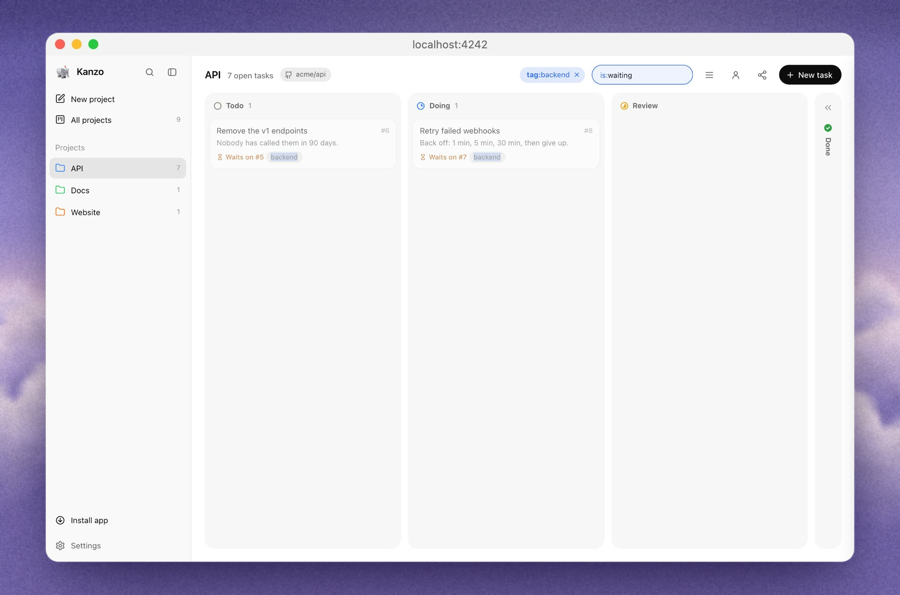
</picture>

| Niteleyici | Bulduğu | Örnek |
| --- | --- | --- |
| `tag:` | tam olarak o etiket | `tag:bug`, `tag:"needs review"` |
| `status:` | bir sütun | `status:doing` |
| `project:` | bir proje | `project:api` |
| `title:`, `description:`, `url:`, `comment:` | o alandaki metin | `title:login`, `comment:"on hold"` |
| `id:`, `comments:`, `images:` | bir sayı ya da aralık | `id:12`, `comments:>2`, `images:1..3` |
| `created:`, `updated:` | bir tarih ya da aralık | `created:2026-11-05`, `updated:<2026-01-31` |
| `is:human` | ajanlara değil, sana ait görevler | `-is:human` |
| `is:waiting` | bitmemiş görevleri bekleyen görevler | `-is:waiting` |
| `is:escalated` | bir ajanın sana devrettiği görevler | `is:escalated` |
| `has:`, `no:` | `description`, `tags`, `url`, `comments` ya da `images` | `has:url`, `no:tags` |

Geri kalan her şey düz metindir. Bir ifade için tırnak kullan, `"on hold"`; niteleyiciye benzeyen bir metni aramak için de, `"tag:bug"`. Ajanlar, Settings'te gizlediğin bir özellik üzerinden filtreleme yapamaz.

## Birden çok bilgisayarda kullan

İki yol var, ikisi de kurulum gerektirmez: tek panoyu canlı paylaş ya da makineler arasında eşitle.

### Canlı paylaş

> [!TIP]
> **Ajanına söylemen yeterli:** bir bilgisayarda *"Kanzo panomu paylaş,"* diğerlerinde *"192.168.1.20 adresindeki Kanzo panosuna katıl."*

Birden çok bilgisayar, tek pano, aynı anda: herkes aynı görevleri görür ve her ajan onlar üzerinde çalışır.

1. Panonun bulunduğu bilgisayarda New task'ın yanındaki paylaşma simgesine tıkla ve **Share this board**'u aç. Gösterdiği adreslerden birini kopyala.

<picture>
  <source media="(prefers-color-scheme: dark)" srcset="docs/img/share-dark.jpg">
  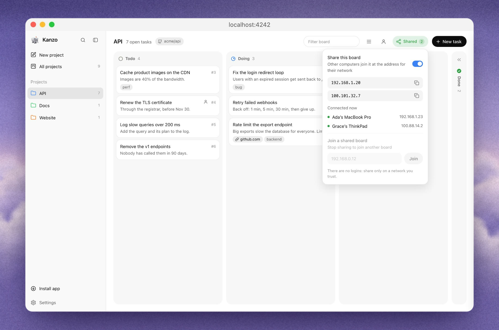
</picture>

2. Diğer her bilgisayarda paylaşma simgesine tıkla, adresi yapıştır ve **Join**'e tıkla.

<picture>
  <source media="(prefers-color-scheme: dark)" srcset="docs/img/join-dark.jpg">
  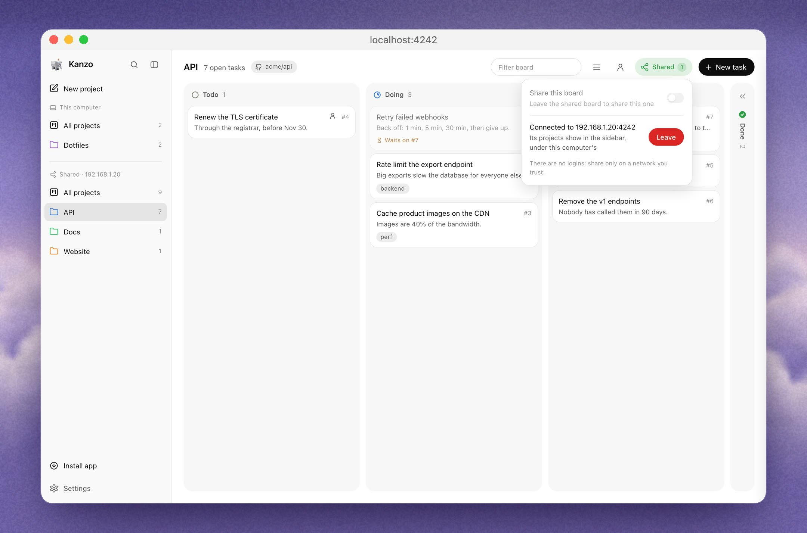
</picture>

Hiçbir şey yeniden başlamaz ve hiçbir şeyi ayarlamak gerekmez. Kenar çubukları, paylaşılan panonun projelerini kendi projelerinin altında gösterir, böylece özel projeleri bir tık uzakta kalır; ajanları da paylaşılan panoyu aynı `kanzo mcp` üzerinden kullanır ve projeyi hâlâ çalıştıkları repodan bulur. Paylaşımı istediğin an kapat ya da **Leave**'e tıkla.

Terminalden ya da bir ajan için bu `kanzo share on` ve `kanzo join <adres>`, sonra da `kanzo share off` ve `kanzo leave` komutlarıdır.

Pano nerede durursa dursun aynı iki komut çalışır; yalnızca adres değişir:

**Senin bilgisayarın panosunu paylaşır.** Diğerleri aynı ağda, kendi bilgisayarlarından katılır.

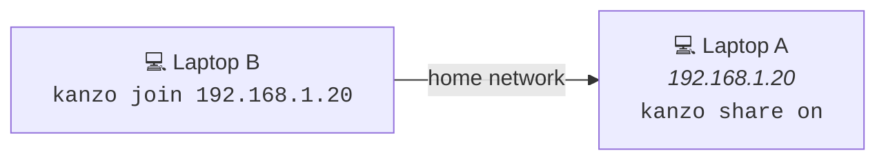

**Panoyu bir Raspberry Pi tutar.** Her bilgisayar ona katılır ve hiçbirinin açık kalması gerekmez.

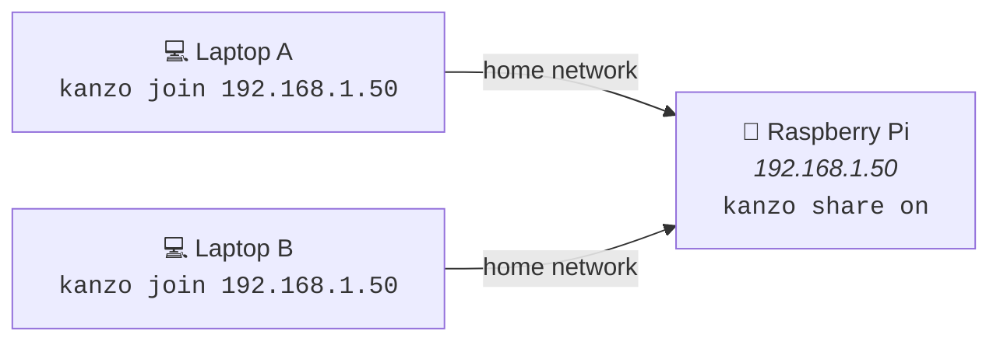

**Raspberry Pi başka bir yerde, internet üzerinden.** Pi'ye ve her bilgisayara [Tailscale](https://tailscale.com), [NetBird](https://netbird.io) ya da WireGuard gibi bir VPN kur: `kanzo share on` o zaman Pi'nin VPN adresini de gösterir.

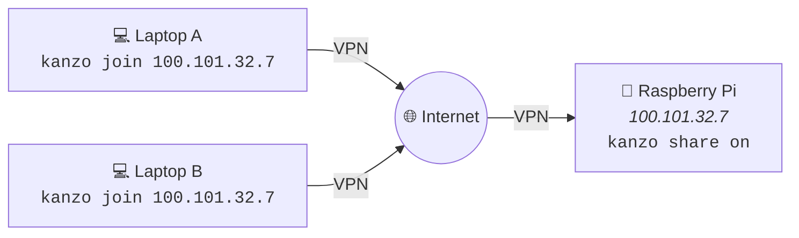

Bir Pi'de `kanzo service install`, yeniden başlatmadan sonra panonun çalışmaya devam etmesini sağlar. Oturum açma yoktur: yalnızca güvendiğin bir ağda paylaş.

### Makineler arasında eşitle

> [!TIP]
> **Ajanına söylemen yeterli:** *"Kanzo panomu eşitle,"* ya da ilk seferde *"Kanzo eşitlemesini github.com/sen/kanzo-data ile kur."*

Sırayla kullandığın makineler arasında panoyu taşımak için, sahibi olduğun özel bir git reposu panoyu eşit tutar.

1. GitHub'da ya da git'in push yapabildiği herhangi bir yerde [boş bir özel repo oluştur](https://github.com/new?name=kanzo-data&visibility=private).
2. Kenar çubuğunun altındaki Settings'e tıkla, Sync'i seç ve reponun URL'sini yapıştır. Kanzo `~/kanzo`'yu bir git reposu yapar ve panoyu push eder.
3. Diğer her makinede aynı URL ile aynısını yap: Kanzo orada zaten bulunan panoyu kullanmayı önerir.

Bundan sonra makine değiştirdiğinde Sync'i seç ya da `kanzo sync` çalıştır. Panoyu commit eder, pull ya da push yapar; pano ve ajanların çalışırken de güvenlidir. İki makine de panoyu değiştirdiyse Kanzo hangisinin kalacağını sorar. Başka bir repoya geçmek için Settings'te, Sync altında değiştir.

## Komutlar

| Komut | Ne yapar |
| --- | --- |
| `kanzo` | Panoyu http://localhost:4242 adresinde başlatır ve açar; başka port için `--port`, açmamak için `--no-open` |
| `kanzo service install` | Panoyu çalışır tutar ve oturum açılınca başlatır; `uninstall` kaldırır |
| `kanzo mcp` | Ajanlar için MCP sunucusu: onu sen değil, ajanlar başlatır |
| `kanzo share on` | Panoyu ağındaki diğer bilgisayarlarla paylaşır; `off` paylaşımı durdurur, pano çalışmaya devam eder |
| `kanzo join <ip>` | Başka bir bilgisayarın paylaştığı panoyu bu bilgisayarın panosundan ve ajanlarından kullanır; `kanzo leave` geri döner |
| `kanzo sync` | Panoyu commit eder, pull ya da push yapar; `--repo <url>` repoyu ayarlar, iki taraf da değiştiyse `--keep-local` ya da `--keep-remote` |
| `kanzo export` | Panoyu Markdown olarak yazdırır; JSON için `-f json`, tek proje için `-p <proje>`, dosyaya kaydetmek için `-o <dosya>` |
| `kanzo update` | Son sürümü kurar ve panonun hizmetini yeniden başlatır; pano da yeni sürümleri önerir |
| `kanzo init` | Veri klasörünü oluşturur; ilk çalıştırma da bunu yapar |
| `kanzo --version` | Sürümü yazdırır |

Her komut, başka bir veri klasörü kullanmak için `--home <klasör>` alır.

## Ayarlar

> [!TIP]
> **Ajanına söylemen yeterli:** *"Kanzo'yu 4300 portunda çalıştır."*

Her şey `~/kanzo` içinde durur: pano `kanzo.db`'de, ayarlar `config.toml`'da. İkisini de açman gerekmez; başka bir klasör için `--home` ya da `KANZO_HOME` kullan.

```toml
port = 4242
listen = "127.0.0.1"   # sharing opens the board to your network; "0.0.0.0" keeps it open
mcp_http = true        # MCP at /mcp
editor = "/usr/local/bin/cursor"   # opens file:/// links; on macOS, your text editor without it
hosts = ["board.example.ts.net"]   # names a reverse proxy here serves the board under; they can't open files or change sharing
```

Bu ayarlar her makinede ayrı kalır: `kanzo sync` onları dışarıda bırakır.

Panodaki ayarlar:

- **Görev özellikleri:** etiketler ya da yorumlar gibi birini kapatırsan panoda gizlenir ve ajanlara gönderilenlerin dışında kalır. Hiçbir şey silinmez.
- **Dil:** Board altında, İngilizce ya da Çince.
- **Tema:** Board altında, sistem, açık ya da koyu.
- **Bildirimler:** Board altında aç; bir ajan bir görevi sana devrettiğinde pano bunu bu bilgisayarda, kendi sekmesinden ya da yüklü uygulamadan bildirir. Bildirime tıklarsan görev orada açılır. Pano açık olduğu sürece, arka planda bile çalışır; pano localhost'ta ya da https ile açık olmalı, çünkü tarayıcılar başka bir bilgisayardan http ile açılan panoya bildirim izni vermez. Pano ilk açıldığında ve her güncellemeden sonra, sen açana ya da kapatana kadar bunu açmayı önerir.
- **What's new:** About altında, bu sürümün notları.

## Küçük ve hızlı

| | |
| --- | --- |
| Program | 4,7 MB, SQLite dahil |
| Bellek | boştayken 5 MB, 3.000 görevle 12 MB |
| Başlama | 3 ms |
| 3.000 görevlik pano | tarayıcıda 17 ms'de yüklenir |
| Ajanların araç listesi | yaklaşık 1.000 token, oturum başına bir kez |
| Ajanların yanıtları | 10 ile 60 token arası düz metin |

Apple M4 üzerinde ölçüldü.

## Lisans

[AGPL-3.0](LICENSE): kullan, değiştir ve paylaş; değiştirilmiş bir sürümü ağ üzerinden sunarsan kaynak kodunu da paylaş. Katkı için [CONTRIBUTING](.github/CONTRIBUTING.md)'e bak.

<sub>mcp-name: io.github.emanuele-em/kanzo</sub>
