<p align="center">
  <picture>
    <source media="(prefers-color-scheme: dark)" srcset="docs/img/kanzo-dark.jpg">
    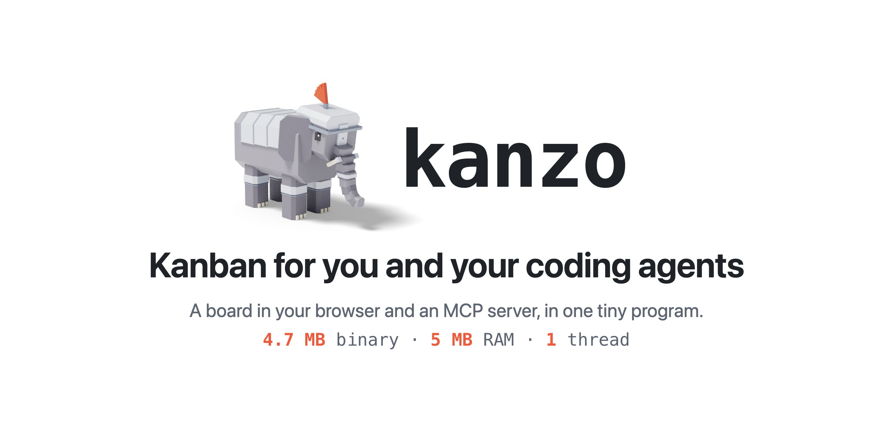
  </picture>
</p>

<p align="center">
  <a href="https://github.com/emanuele-em/kanzo/actions/workflows/ci.yml"></a>
  <a href="https://crates.io/crates/kanzo"></a>
  <a href="LICENSE"></a>
</p>

<p align="center">
  <a href="README.md">English</a> | 简体中文
</p>

Kanzo 把浏览器里的看板和 MCP 服务器装进一个 4.7 MB 的程序，让你和你的编程智能体处理同一批任务：可以在一台电脑上，也可以让多台电脑共享一个看板。无需账号，无需服务器，无需配置：运行 `kanzo` 就能用。

你永远不用手动编辑文件。所有操作都在这三个地方完成：

- **看板**，在浏览器里，给你用；
- **MCP**，给智能体用：它们领取任务、移动卡片、发表评论；
- **`kanzo` 命令**，给终端和脚本用。

<picture>
  <source media="(prefers-color-scheme: dark)" srcset="docs/img/board-dark.gif">
  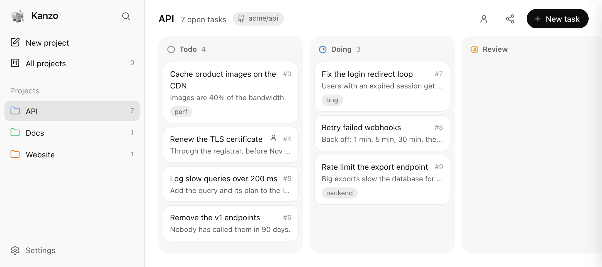
</picture>

## 安装

> [!TIP]
> **直接告诉你的智能体：** *“从 github.com/emanuele-em/kanzo 安装 Kanzo。”*

```sh
curl -LsSf https://github.com/emanuele-em/kanzo/releases/latest/download/kanzo-installer.sh | sh
```

适用于 macOS 和 Linux，包括所有型号的树莓派。在 Windows 上，请在 PowerShell 中运行：

```powershell
powershell -ExecutionPolicy Bypass -c "irm https://github.com/emanuele-em/kanzo/releases/latest/download/kanzo-installer.ps1 | iex"
```

两种方式都会把 Kanzo 加入 `PATH`，对之后新打开的终端生效。要在当前终端使用，请运行 `source $HOME/.cargo/env`（fish 中为 `env.fish`），或者打开一个新终端。

也可以从[最新版本](https://github.com/emanuele-em/kanzo/releases/latest)下载 Windows zip，把 `kanzo.exe` 放到 `PATH` 中名为 `bin` 的文件夹里，比如 `%USERPROFILE%\.cargo\bin`：只有放在这里，看板才能自行更新。

每个版本都由 GitHub 签名：可以用 `gh attestation verify <file> --repo emanuele-em/kanzo` 校验下载的文件。也可以用 Cargo 安装：

```sh
cargo install kanzo
```

## 启动

> [!TIP]
> **直接告诉你的智能体：** *“启动 Kanzo，并让它在登录时保持运行。”*

```sh
kanzo
```

看板会在 http://localhost:4242 打开。这就是全部配置：首次运行时会创建 `~/kanzo`，整个看板都存放在里面。

| 按键 | 作用 |
| --- | --- |
| `n` | 新建任务 |
| `/` 或 `⌘K` | 搜索所有项目 |
| `f` | 筛选看板；`↵` 保留筛选条件 |
| `Tab` | 跳到描述 |
| `⌘↵` | 保存并关闭 |
| `Esc` | 在描述或标签中保留已输入的内容；在其他字段中取消 |

## 使用看板

> [!TIP]
> **直接告诉你的智能体：** *“把 kanzo#12 标记为人工任务，并把它的 URL 设为 github.com/acme/api/pull/482。”*

- **选择任务：** `⌘`-点击任务，或在看板空白处拖动，然后一起移动、加标签或删除。拖动其中一个，其余的会跟着移动。
- **列表视图：** 列表图标会把同样的任务显示成可排序、可分组的行。
- **人工任务：** 把任务标记为“人工”后，智能体会把它留给你。人物图标只显示这些任务。
- **图片：** 粘贴或拖放到任务或评论中。
- **链接：** 给任务设置 URL，比如它的拉取请求，就能从卡片上打开。智能体通过 `url` 设置。
- **文件：** 描述或评论中的 `[name](file:///path)` 会在你的编辑器中打开。
- **任务面板：** 拖动左边缘可调整大小，也可以展开到整个窗口。双击边缘可恢复。
- **侧边栏：** 搜索旁边的面板按钮可以把它折叠成图标。拖动项目可以调整列表顺序，对共享看板上的所有人生效。
- **应用：** 在 Chrome 或 Edge 中，点击侧边栏底部的 **Install app**，可以把看板变成独立的应用。`⌘1`–`⌘8` 选择项目，`⌘9` 选择最后一个，`⌘0` 选择全部。在 macOS 上，之后运行 `kanzo` 会打开这个应用而不是标签页（使用默认端口时）。
- **更新：** 有新版本时，侧边栏会提示。点一下即可安装。

## 连接智能体

> [!TIP]
> **直接告诉你的智能体：** *“把 Kanzo 添加为你的 MCP 服务器，”* 然后重启它。

```sh
claude mcp add kanzo --scope user -- kanzo mcp   # Claude Code
codex mcp add kanzo -- kanzo mcp                 # Codex
```

其他 MCP 客户端：运行 `kanzo mcp`（Raycast 这类应用需要完整路径，可通过 `which kanzo` 获取），或者使用运行中的看板地址 `http://localhost:4242/mcp`。

然后告诉它：*“从 kanzo 领取下一个任务并完成它。”* 智能体会：

- 根据所在仓库的 git remote 找到项目；可以在项目的 ⋯ 菜单中关联更多仓库；
- 把卡片移到 `doing`，并在工作时发表评论；
- 到 `review` 时，在评论中说明如何恢复它的会话。

<picture>
  <source media="(prefers-color-scheme: dark)" srcset="docs/img/task-dark.jpg">
  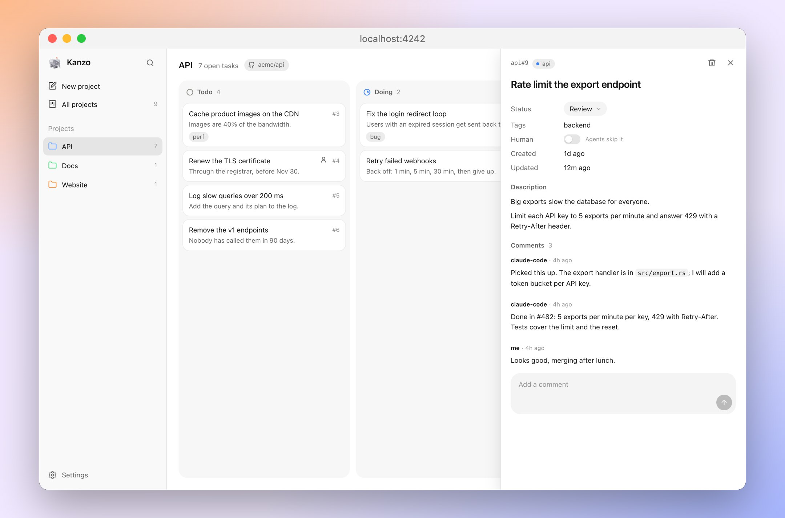
</picture>

## 把想法放进暂存列

在设置中打开“暂存列”，就会多出一列智能体不会碰的任务，直到你把它们移到 `todo`。

<picture>
  <source media="(prefers-color-scheme: dark)" srcset="docs/img/backlog-dark.jpg">
  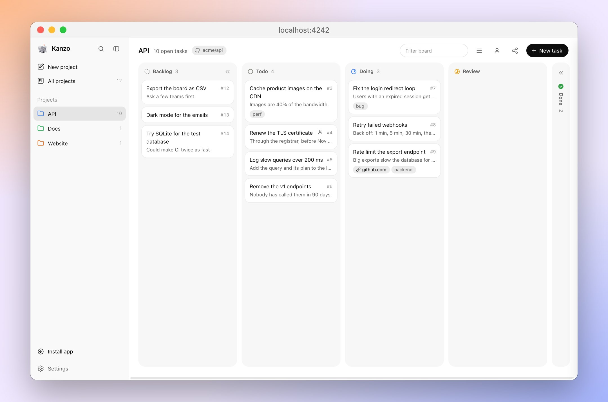
</picture>

## 让任务等待其他任务

> [!TIP]
> **直接告诉你的智能体：** *“让 kanzo#12 等待 #10 和 #11。”*

- **设置：** 在任务面板的 Waits on 中输入内容，查找并选择同一项目中的任务。智能体通过 `waits_on` 传入。
- **在这些任务完成之前：** `next_task` 会跳过它，它的卡片会变暗并显示在等待什么。你仍然可以手动移动它。
- **怎样算完成：** 只有 `done` 才算。处于 `review` 的任务仍会阻塞。
- **查找：** 用 `is:waiting` 筛选。

<picture>
  <source media="(prefers-color-scheme: dark)" srcset="docs/img/waits-dark.jpg">
  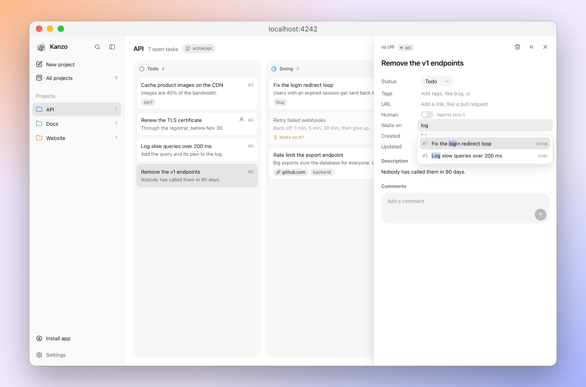
</picture>

## 响应变化

服务可以跟随看板的变化做出反应，例如任务进入 `todo` 时启动一个智能体，而不必一遍遍读取整个看板。

- **开始：** `GET /api/events` 返回 `{"events": [], "last": 41}`。记住 `last`。
- **跟随：** `GET /api/events?since=41&wait=25` 一有变化就返回，25 秒内没有事件也会返回。下次传入新的 `last`。加上 `project=api` 只看一个项目。
- **内容：** 每个事件有 `id`、`at`、`kind`（`task.created`、`task.moved`、`task.updated`、`task.deleted`、`comment.added`）、`task`（如 `api#12`）、`project`，适用时还有 `from` 和 `to`（列）以及评论的 `author`。一次编辑就是一个事件；在同一列内调整顺序不算事件。
- **不会丢失：** 事件与变更写在同一个事务里。保留最近 10,000 个。
- 回复中出现 `"reset": true` 时**重新开始**：`since` 之后的事件已被丢弃，或看板已被替换（例如 `kanzo sync`）。重新读取看板，然后从 `last` 继续。

## 筛选和搜索

> [!TIP]
> **直接告诉你的智能体：** *“领取下一个带 billing 标签的 kanzo 任务，”* 或 *“用 tag:billing 列出 kanzo 中剩下的任务。”*

看板的筛选（`f`）、搜索（`/`），以及 `list_tasks` 和 `next_task` 的 `filter` 都使用同样的语法，和 GitHub 类似：

- 每个部分都必须匹配。
- `-` 表示排除某个限定符：`tag:billing -status:done`。
- 输入限定符时，它会变成蓝色。

<picture>
  <source media="(prefers-color-scheme: dark)" srcset="docs/img/filter-dark.jpg">
  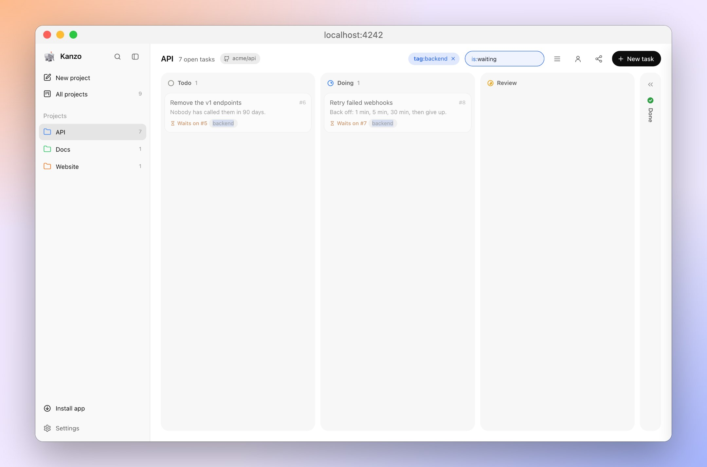
</picture>

| 限定符 | 查找 | 示例 |
| --- | --- | --- |
| `tag:` | 完全相同的标签 | `tag:bug`, `tag:"needs review"` |
| `status:` | 某一列 | `status:doing` |
| `project:` | 某个项目 | `project:api` |
| `title:`, `description:`, `url:`, `comment:` | 该字段中的文字 | `title:login`, `comment:"on hold"` |
| `id:`, `comments:`, `images:` | 一个数字或范围 | `id:12`, `comments:>2`, `images:1..3` |
| `created:`, `updated:` | 一个日期或范围 | `created:2026-11-05`, `updated:<2026-01-31` |
| `is:human` | 留给你而不是智能体的任务 | `-is:human` |
| `is:waiting` | 正在等待未完成任务的任务 | `-is:waiting` |
| `has:`, `no:` | `description`、`tags`、`url`、`comments` 或 `images` | `has:url`, `no:tags` |

其他内容都按普通文本处理。用引号表示短语，如 `"on hold"`，或者查找看起来像限定符的文本，如 `"tag:bug"`。智能体无法通过你在设置中隐藏的属性进行筛选。

## 在多台电脑上使用

有两种方式，都不需要任何配置：实时共享一个看板，或者在电脑之间同步。

### 实时共享

> [!TIP]
> **直接告诉你的智能体：** 在一台电脑上说 *“共享我的 Kanzo 看板”*，在其他电脑上说 *“加入 192.168.1.20 上的 Kanzo 看板”*。

多台电脑，一个看板，同时使用：所有人看到相同的任务，所有智能体都在上面工作。

1. 在存放看板的电脑上，点击“新建任务”旁边的共享图标，打开 **共享此看板**。复制它显示的一个地址。

<picture>
  <source media="(prefers-color-scheme: dark)" srcset="docs/img/share-dark.jpg">
  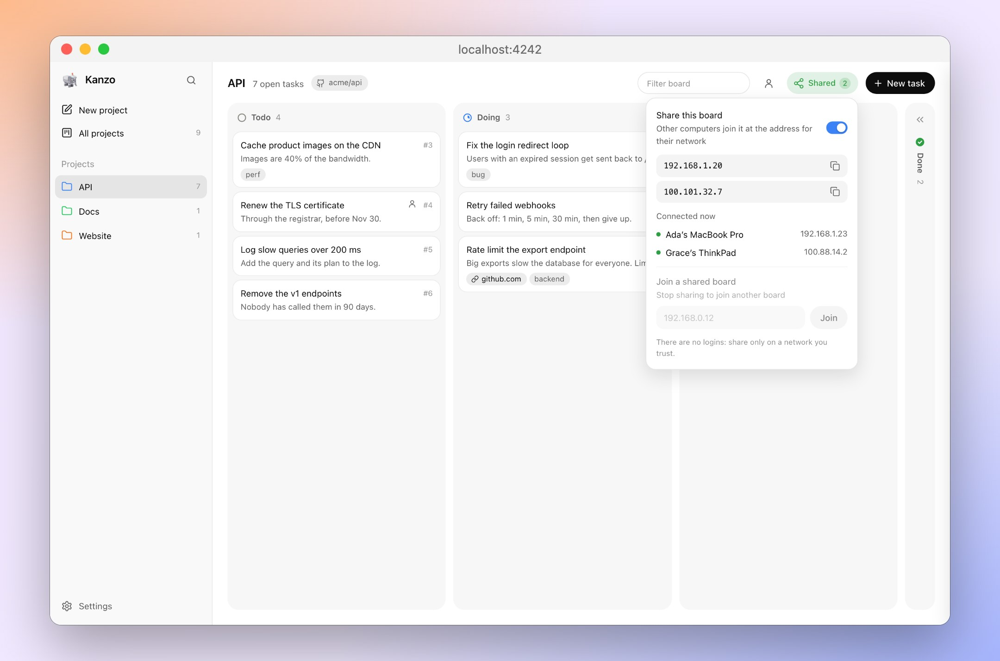
</picture>

2. 在其他每台电脑上，点击共享图标，粘贴地址，然后点击 **加入**。

<picture>
  <source media="(prefers-color-scheme: dark)" srcset="docs/img/join-dark.jpg">
  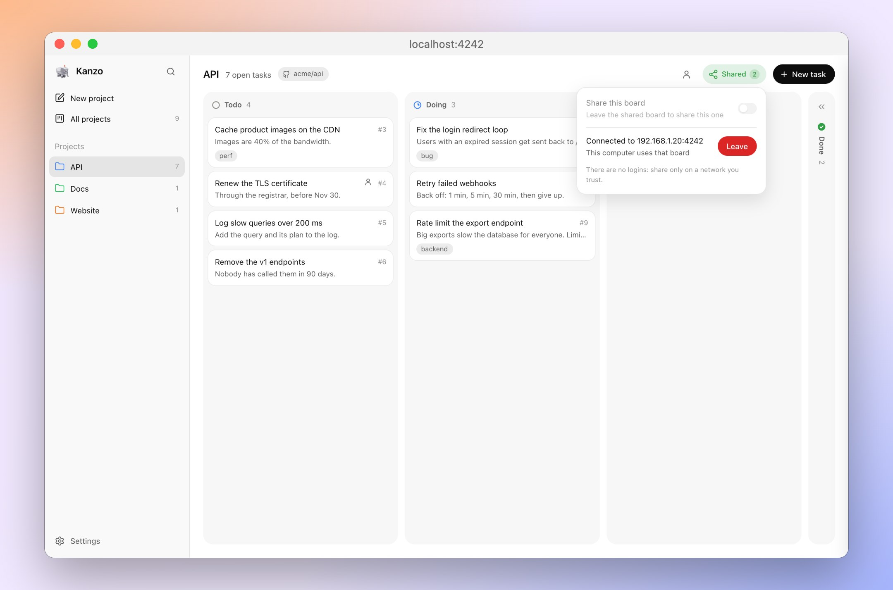
</picture>

不用重启，也不用配置。它们的看板会显示共享的看板，它们的智能体通过同样的 `kanzo mcp` 使用它，仍然根据所在仓库找到项目。你可以随时关闭共享，或点击 **离开**。

在终端中，或者对智能体来说，命令是 `kanzo share on` 和 `kanzo join <address>`，然后是 `kanzo share off` 和 `kanzo leave`。

无论看板放在哪里，都是这两条命令，只有地址不同：

**你的电脑共享看板。** 同一网络中的其他电脑从自己那边加入。

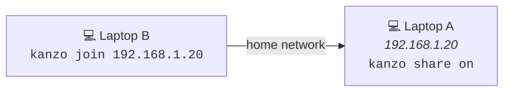

**树莓派存放看板。** 每台电脑都加入它，哪台都不必一直开机。

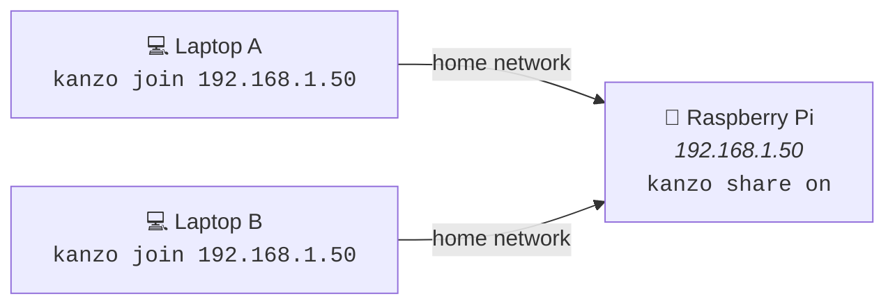

**树莓派在别处，通过互联网访问。** 在树莓派和每台电脑上安装 VPN，比如 [Tailscale](https://tailscale.com)、[NetBird](https://netbird.io) 或 WireGuard：这样 `kanzo share on` 也会显示树莓派的 VPN 地址。

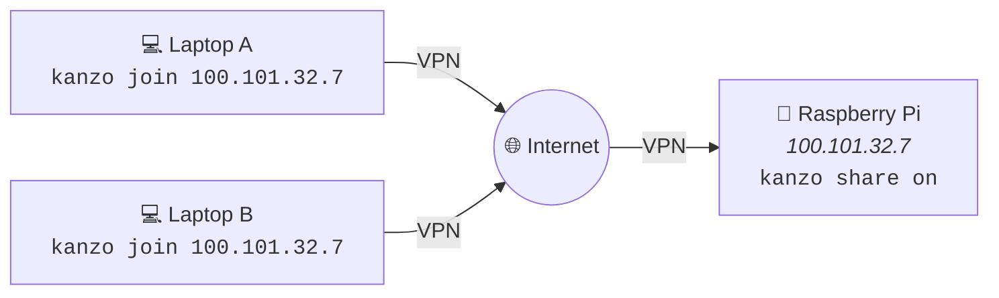

在树莓派上，`kanzo service install` 能让看板在重启后继续运行。没有登录机制：请只在可信的网络里共享。

### 在电脑之间同步

> [!TIP]
> **直接告诉你的智能体：** *“同步我的 Kanzo 看板，”* 或者第一次时说 *“用 github.com/you/kanzo-data 设置 Kanzo 同步。”*

如果你轮流使用几台电脑，可以用一个你自己的私有 git 仓库让看板保持一致。

1. 在 GitHub 或任何支持 git push 的地方[新建一个空的私有仓库](https://github.com/new?name=kanzo-data&visibility=private)。
2. 点击侧边栏底部的“设置”，选择 Sync，粘贴仓库 URL。Kanzo 会把 `~/kanzo` 变成 git 仓库并推送看板。
3. 在其他每台电脑上，用同一个 URL 重复这一步：Kanzo 会询问是否使用已有的看板。

之后每次换电脑时，选择 Sync 或运行 `kanzo sync`。它会提交看板并拉取或推送，在看板和智能体运行时也能安全使用。如果两台电脑都改动了看板，Kanzo 会询问保留哪一个。要换一个仓库，请到设置的 Sync 中修改。

## 命令

| 命令 | 作用 |
| --- | --- |
| `kanzo` | 在 http://localhost:4242 启动并打开看板；`--port` 指定其他端口，`--no-open` 不打开 |
| `kanzo service install` | 让看板保持运行并在登录时启动；`uninstall` 移除 |
| `kanzo mcp` | 给智能体用的 MCP 服务器：由它们启动，不用你启动 |
| `kanzo share on` | 把看板共享给网络中的其他电脑；`off` 停止共享，看板继续运行 |
| `kanzo join <ip>` | 让这台电脑的看板和智能体使用另一台电脑共享的看板；`kanzo leave` 退回 |
| `kanzo sync` | 提交看板并拉取或推送；`--repo <url>` 设置仓库，两边都有改动时用 `--keep-local` 或 `--keep-remote` |
| `kanzo export` | 以 Markdown 输出看板；`-f json` 输出 JSON，`-p <project>` 只输出一个项目，`-o <file>` 保存到文件 |
| `kanzo update` | 安装最新版本并重启看板服务；看板也会提示新版本 |
| `kanzo init` | 创建数据文件夹；首次运行时也会创建 |
| `kanzo --version` | 输出版本号 |

每个命令都接受 `--home <dir>`，用来指定其他数据文件夹。

## 设置

> [!TIP]
> **直接告诉你的智能体：** *“在 4300 端口运行 Kanzo。”*

所有内容都在 `~/kanzo` 里：看板在 `kanzo.db`，设置在 `config.toml`。你不需要打开它们；可以用 `--home` 或 `KANZO_HOME` 指定其他文件夹。

```toml
port = 4242
listen = "127.0.0.1"   # 共享会把看板开放给你的网络；"0.0.0.0" 会让它一直开放
mcp_http = true        # MCP 地址为 /mcp
editor = "/usr/local/bin/cursor"   # 用来打开 file:/// 链接；在 macOS 上不设置时使用你的文本编辑器
```

这些设置只保存在各自的电脑上：`kanzo sync` 不会同步它们。

看板上的设置：

- **任务属性：** 关掉一项，比如标签或评论，它就会在看板上隐藏，智能体也拿不到它。内容不会被删除。
- **界面语言：** 英文或中文，在“看板”下。
- **更新内容：** 当前版本的说明，在“关于”下。

## 小而快

| | |
| --- | --- |
| 程序 | 4.7 MB，包含 SQLite |
| 内存 | 空闲时 5 MB，3,000 个任务时 12 MB |
| 启动 | 3 ms |
| 3,000 个任务的看板 | 在浏览器中加载 17 ms |
| 智能体的工具列表 | 约 1,000 tokens，每个会话一次 |
| 智能体的回复 | 10 到 60 tokens 的纯文本 |

在 Apple M4 上测量。

## 许可证

[AGPL-3.0](LICENSE)：可以使用、修改和分享；如果你通过网络提供修改后的版本，也要分享它的源代码。想要参与，请看 [CONTRIBUTING](.github/CONTRIBUTING.md)。

<sub>mcp-name: io.github.emanuele-em/kanzo</sub>
